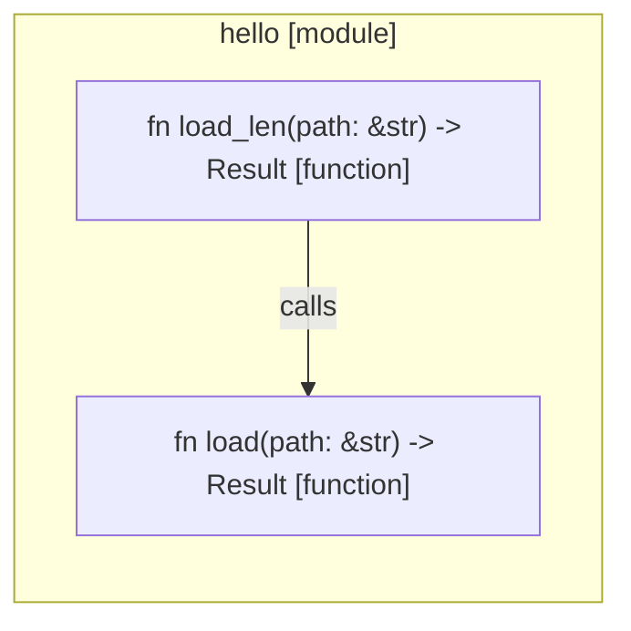
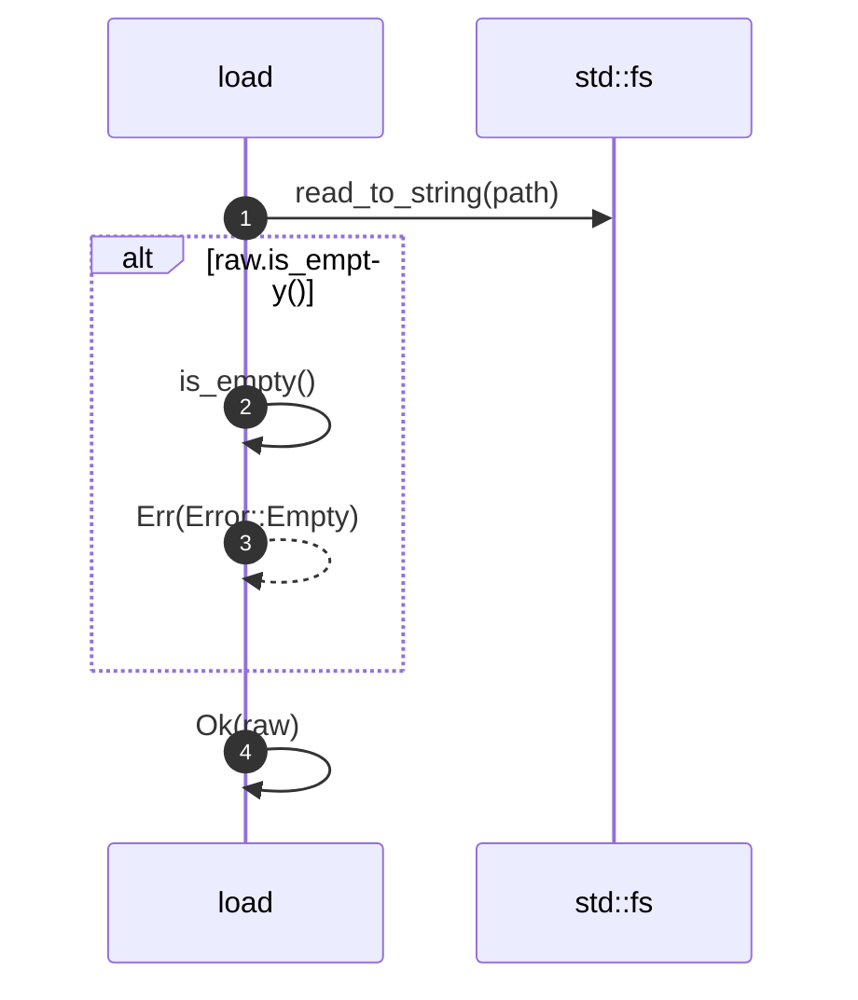
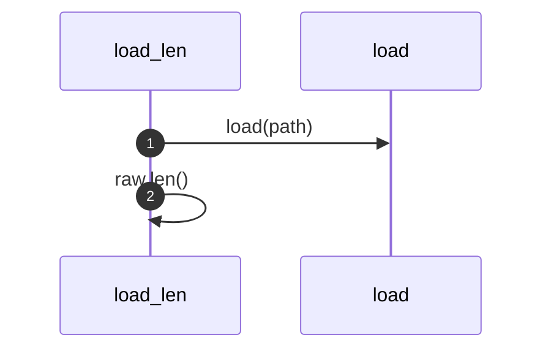

# Robby self-model

> Generated by `robby-fixture-m0` · schema v1 · 3 nodes

This file is generated. Do not edit it by hand: run `robby report` instead.

## Coverage

| File | Code | Claimed | Trivia | Status |
|---|---:|---:|---:|---|
| `fixtures/m0/hello.rs` | 100.0% | 274/274 | 136 | ok |

Every byte is owned by a node or classified as trivia.

## Graph — `rust://hello`



## Nodes

### `hello`

| | |
|---|---|
| kind | `code.module` |
| id | `rust://hello` |
| provenance | hand · confidence 1.00 |

**Children** — `hello::load`, `hello::load_len`

#### `hello::load`

| | |
|---|---|
| kind | `code.function` |
| id | `rust://hello::load` |
| signature | `fn load(path: &str) -> Result<String, Error>` |
| location | `fixtures/m0/hello.rs:4:1` |
| span | bytes 90..264 |
| provenance | hand · confidence 1.00 |

> Loads a config file, failing on empty input.

```rust
pub fn load(path: &str) -> Result<String, Error> {
    let raw = std::fs::read_to_string(path)?;
    if raw.is_empty() {
        return Err(Error::Empty);
    }
    Ok(raw)
}
```



4 steps · 3 observed · 1 possible only

#### `hello::load_len`

| | |
|---|---|
| kind | `code.function` |
| id | `rust://hello::load_len` |
| signature | `fn load_len(path: &str) -> Result<usize, Error>` |
| location | `fixtures/m0/hello.rs:13:1` |
| span | bytes 309..409 |
| provenance | hand · confidence 1.00 |

> Loads a config and reports its length.

```rust
pub fn load_len(path: &str) -> Result<usize, Error> {
    let raw = load(path)?;
    Ok(raw.len())
}
```



2 steps · 2 observed · 0 possible only

**Edges**

- calls → `rust://hello::load`

