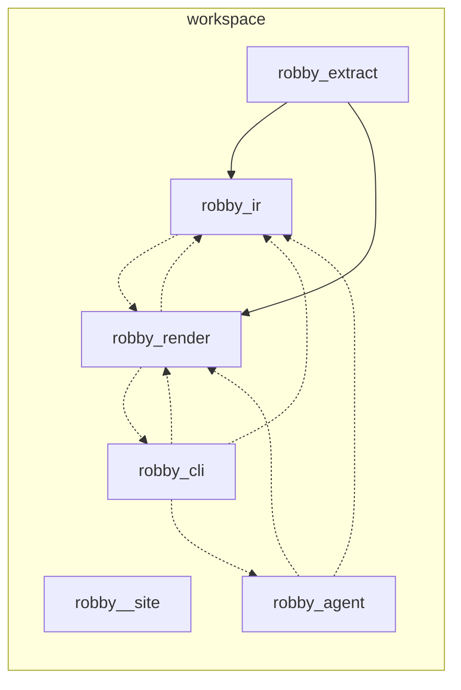

# Robby self-model

> Generated by `robby-extract` · schema v1 · 1586 nodes · 53 files

This tree is generated. Do not edit it by hand: run `cargo run -p robby-cli -- report`.

## Coverage

| File | Code | Claimed | Trivia | Status |
|---|---:|---:|---:|---|
| `apps/site/src/viewer.ts` | 100.0% | 18189/18189 | 0 | ok |
| `crates/robby-agent/src/context.rs` | 100.0% | 5991/5991 | 93 | ok |
| `crates/robby-agent/src/enrich.rs` | 100.0% | 9291/9291 | 82 | ok |
| `crates/robby-agent/src/lib.rs` | 100.0% | 378/378 | 214 | ok |
| `crates/robby-agent/src/model.rs` | 100.0% | 6714/6714 | 103 | ok |
| `crates/robby-agent/src/openrouter.rs` | 100.0% | 3156/3156 | 57 | ok |
| `crates/robby-cli/build.rs` | 100.0% | 1767/1767 | 705 | ok |
| `crates/robby-cli/examples/self-model.rs` | 100.0% | 2547/2547 | 763 | ok |
| `crates/robby-cli/src/main.rs` | 100.0% | 14134/14134 | 220 | ok |
| `crates/robby-extract/src/lib.rs` | 100.0% | 785/785 | 394 | ok |
| `crates/robby-extract/src/rust.rs` | 100.0% | 33206/33206 | 654 | ok |
| `crates/robby-extract/src/typescript.rs` | 100.0% | 35542/35542 | 182 | ok |
| `crates/robby-extract/tests/extract.rs` | 100.0% | 2592/2592 | 181 | ok |
| `crates/robby-extract/tests/typescript.rs` | 100.0% | 5257/5257 | 84 | ok |
| `crates/robby-ir/src/codepath.rs` | 100.0% | 5678/5678 | 398 | ok |
| `crates/robby-ir/src/coverage.rs` | 100.0% | 12569/12569 | 781 | ok |
| `crates/robby-ir/src/kind.rs` | 100.0% | 3147/3147 | 566 | ok |
| `crates/robby-ir/src/lib.rs` | 100.0% | 1066/1066 | 815 | ok |
| `crates/robby-ir/src/model.rs` | 100.0% | 24377/24377 | 208 | ok |
| `crates/robby-ir/src/process.rs` | 100.0% | 5906/5906 | 607 | ok |
| `crates/robby-ir/src/span.rs` | 100.0% | 2062/2062 | 275 | ok |
| `crates/robby-ir/src/vocab.rs` | 100.0% | 2452/2452 | 239 | ok |
| `crates/robby-ir/tests/coverage.rs` | 100.0% | 7997/7997 | 299 | ok |
| `crates/robby-render/src/lib.rs` | 100.0% | 3319/3319 | 505 | ok |
| `crates/robby-render/src/markdown.rs` | 100.0% | 8094/8094 | 315 | ok |
| `crates/robby-render/src/pipeline.rs` | 100.0% | 6044/6044 | 407 | ok |
| `crates/robby-render/src/render/markdown.rs` | 100.0% | 6350/6350 | 240 | ok |
| `crates/robby-render/src/render/mermaid.rs` | 100.0% | 11787/11787 | 80 | ok |
| `crates/robby-render/src/render/mod.rs` | 100.0% | 4171/4171 | 141 | ok |
| `crates/robby-render/src/render/tui.rs` | 100.0% | 19571/19571 | 105 | ok |
| `crates/robby-render/src/report.rs` | 100.0% | 3014/3014 | 309 | ok |
| `crates/robby-render/src/tree.rs` | 100.0% | 24538/24538 | 1444 | ok |
| `crates/robby-render/src/tui.rs` | 100.0% | 1375/1375 | 164 | ok |
| `crates/robby-render/src/util.rs` | 100.0% | 2628/2628 | 75 | ok |
| `crates/robby-render/src/view/comments.rs` | 100.0% | 8270/8270 | 95 | ok |
| `crates/robby-render/src/view/deps.rs` | 100.0% | 27815/27815 | 138 | ok |
| `crates/robby-render/src/view/entrypoints.rs` | 100.0% | 6609/6609 | 269 | ok |
| `crates/robby-render/src/view/execution.rs` | 100.0% | 5092/5092 | 314 | ok |
| `crates/robby-render/src/view/externals.rs` | 100.0% | 2959/2959 | 77 | ok |
| `crates/robby-render/src/view/hierarchy.rs` | 100.0% | 2980/2980 | 48 | ok |
| `crates/robby-render/src/view/links.rs` | 100.0% | 3828/3828 | 67 | ok |
| `crates/robby-render/src/view/mod.rs` | 100.0% | 1169/1169 | 221 | ok |
| `crates/robby-render/src/view/process.rs` | 100.0% | 3191/3191 | 109 | ok |
| `crates/robby-render/src/view/scene.rs` | 100.0% | 16856/16856 | 134 | ok |
| `crates/robby-render/src/view/select.rs` | 100.0% | 5566/5566 | 70 | ok |
| `crates/robby-render/src/view/sibling.rs` | 100.0% | 3007/3007 | 76 | ok |
| `crates/robby-render/src/view/source.rs` | 100.0% | 597/597 | 48 | ok |
| `crates/robby-render/src/view/types.rs` | 100.0% | 7684/7684 | 72 | ok |
| `crates/robby-render/src/web.rs` | 100.0% | 5576/5576 | 319 | ok |
| `crates/robby-render/tests/markdown.rs` | 100.0% | 2719/2719 | 114 | ok |
| `crates/robby-render/tests/render.rs` | 100.0% | 15234/15234 | 107 | ok |
| `crates/robby-render/tests/tree.rs` | 100.0% | 4745/4745 | 163 | ok |
| `crates/robby-render/tests/web.rs` | 100.0% | 12173/12173 | 81 | ok |

Every byte is owned by a node or classified as trivia.

## Crates

| Crate | Modules | Nodes |
|---|---:|---:|
| [`robby_agent`](robby_agent/index.md) | 6 | 128 |
| [`robby_cli`](robby_cli/index.md) | 2 | 62 |
| [`robby_extract`](robby_extract/index.md) | 5 | 164 |
| [`robby_ir`](robby_ir/index.md) | 15 | 397 |
| [`robby_render`](robby_render/index.md) | 31 | 784 |
| [`robby__site`](robby__site/index.md) | 1 | 51 |

## Package diagram

## Module coupling

```mermaid
flowchart TB
    subgraph n_b21644687b040c6e["workspace"]
        direction TB
        subgraph n_f3e9f97d91a4f4af["robby_agent"]
            direction TB
            n_8ece825e5a096dd6["context"]
            n_fcd74fcd7fa20296["enrich"]
            n_86f239b07be3914c["model"]
            n_e78ea7618cf62376["openrouter"]
        end
        subgraph n_a331a60ee1568354["robby_cli"]
            direction TB
            n_874b29800ed524d0["build"]
            n_c58f68f7fc449f63["example_self_model"]
        end
        subgraph n_ea78dce2fbcbf64f["robby_extract"]
            direction TB
            n_a95c010a8299da11["rust"]
            n_286b1b9602b65f8d["test_extract"]
            n_707c83973fcabf1f["test_typescript"]
            n_65efc424c4086ad0["typescript"]
        end
        subgraph n_356bf2c23da68961["robby_ir"]
            direction TB
            n_c28bfd08cdfce4bf["codepath"]
            n_965af55f4081b03f["coverage"]
            n_611ba0cee1ac191f["kind"]
            n_48c15551e2e91996["model"]
            n_f5e61214f719e7ae["process"]
            n_9053aa1513b08ea5["span"]
            n_46b0c6f667b1fb40["test_coverage"]
            n_3ab04153eeb89900["vocab"]
        end
        subgraph n_9c636b098ca4450e["robby_render"]
            direction TB
            n_58704dd7dd5e44a7["markdown"]
            n_77294f3b6f21b79c["pipeline"]
            n_c53db78a9ef33eb6["render"]
            n_05b9b679aaf35ec8["report"]
            n_94a590d1410dd3da["test_markdown"]
            n_092b7abcfcf260db["test_render"]
            n_2790416a72a81c1b["test_tree"]
            n_310d14cf579135a7["test_web"]
            n_d59428013b05fa6e["tree"]
            n_4fd64543ae69ff04["tui"]
            n_23dac307afb8bcf6["util"]
            n_ca65ecef8a7529fb["view"]
            n_458e2543a821af84["web"]
        end
    end
    n_05b9b679aaf35ec8 -.->|"1 circular"| n_c53db78a9ef33eb6
    n_05b9b679aaf35ec8 -.->|"3 circular"| n_ca65ecef8a7529fb
    n_092b7abcfcf260db -.->|"40 circular"| n_05b9b679aaf35ec8
    n_092b7abcfcf260db -.->|"71 circular"| n_48c15551e2e91996
    n_092b7abcfcf260db -.->|"1 circular"| n_58704dd7dd5e44a7
    n_092b7abcfcf260db -->|"19"| n_611ba0cee1ac191f
    n_092b7abcfcf260db -.->|"2 circular"| n_c53db78a9ef33eb6
    n_092b7abcfcf260db -.->|"4 circular"| n_ca65ecef8a7529fb
    n_092b7abcfcf260db -.->|"2 circular"| n_f5e61214f719e7ae
    n_23dac307afb8bcf6 -.->|"5 circular"| n_05b9b679aaf35ec8
    n_23dac307afb8bcf6 -.->|"1 circular"| n_48c15551e2e91996
    n_23dac307afb8bcf6 --> n_611ba0cee1ac191f
    n_23dac307afb8bcf6 -.->|"4 circular"| n_ca65ecef8a7529fb
    n_2790416a72a81c1b -->|"9"| n_05b9b679aaf35ec8
    n_2790416a72a81c1b -->|"2"| n_48c15551e2e91996
    n_2790416a72a81c1b --> n_4fd64543ae69ff04
    n_2790416a72a81c1b --> n_611ba0cee1ac191f
    n_2790416a72a81c1b -->|"3"| n_ca65ecef8a7529fb
    n_286b1b9602b65f8d --> n_48c15551e2e91996
    n_286b1b9602b65f8d --> n_611ba0cee1ac191f
    n_286b1b9602b65f8d -->|"2"| n_965af55f4081b03f
    n_286b1b9602b65f8d --> n_a95c010a8299da11
    n_286b1b9602b65f8d --> n_ca65ecef8a7529fb
    n_310d14cf579135a7 -->|"28"| n_05b9b679aaf35ec8
    n_310d14cf579135a7 --> n_092b7abcfcf260db
    n_310d14cf579135a7 -->|"7"| n_458e2543a821af84
    n_310d14cf579135a7 -->|"36"| n_48c15551e2e91996
    n_310d14cf579135a7 -->|"6"| n_611ba0cee1ac191f
    n_310d14cf579135a7 -->|"7"| n_77294f3b6f21b79c
    n_310d14cf579135a7 -->|"9"| n_ca65ecef8a7529fb
    n_310d14cf579135a7 --> n_f5e61214f719e7ae
    n_458e2543a821af84 --> n_05b9b679aaf35ec8
    n_458e2543a821af84 -->|"2"| n_092b7abcfcf260db
    n_458e2543a821af84 -->|"3"| n_48c15551e2e91996
    n_458e2543a821af84 --> n_611ba0cee1ac191f
    n_458e2543a821af84 -.->|"1 circular"| n_77294f3b6f21b79c
    n_458e2543a821af84 -->|"11"| n_ca65ecef8a7529fb
    n_46b0c6f667b1fb40 -->|"16"| n_48c15551e2e91996
    n_46b0c6f667b1fb40 -->|"24"| n_611ba0cee1ac191f
    n_46b0c6f667b1fb40 -->|"19"| n_965af55f4081b03f
    n_46b0c6f667b1fb40 --> n_ca65ecef8a7529fb
    n_48c15551e2e91996 -.->|"18 circular"| n_05b9b679aaf35ec8
    n_48c15551e2e91996 --> n_611ba0cee1ac191f
    n_48c15551e2e91996 -.->|"1 circular"| n_c28bfd08cdfce4bf
    n_48c15551e2e91996 -.->|"6 circular"| n_ca65ecef8a7529fb
    n_4fd64543ae69ff04 -->|"4"| n_05b9b679aaf35ec8
    n_4fd64543ae69ff04 --> n_092b7abcfcf260db
    n_4fd64543ae69ff04 -.->|"1 circular"| n_458e2543a821af84
    n_4fd64543ae69ff04 -->|"5"| n_c53db78a9ef33eb6
    n_4fd64543ae69ff04 -->|"3"| n_ca65ecef8a7529fb
    n_58704dd7dd5e44a7 -.->|"16 circular"| n_05b9b679aaf35ec8
    n_58704dd7dd5e44a7 -.->|"1 circular"| n_092b7abcfcf260db
    n_58704dd7dd5e44a7 -.->|"6 circular"| n_48c15551e2e91996
    n_58704dd7dd5e44a7 -->|"2"| n_611ba0cee1ac191f
    n_58704dd7dd5e44a7 -.->|"3 circular"| n_965af55f4081b03f
    n_58704dd7dd5e44a7 -.->|"4 circular"| n_c53db78a9ef33eb6
    n_58704dd7dd5e44a7 -.->|"9 circular"| n_ca65ecef8a7529fb
    n_65efc424c4086ad0 -->|"27"| n_05b9b679aaf35ec8
    n_65efc424c4086ad0 --> n_092b7abcfcf260db
    n_65efc424c4086ad0 --> n_3ab04153eeb89900
    n_65efc424c4086ad0 -->|"44"| n_48c15551e2e91996
    n_65efc424c4086ad0 -->|"21"| n_611ba0cee1ac191f
    n_65efc424c4086ad0 -->|"6"| n_9053aa1513b08ea5
    n_65efc424c4086ad0 --> n_965af55f4081b03f
    n_65efc424c4086ad0 -->|"23"| n_a95c010a8299da11
    n_65efc424c4086ad0 -->|"3"| n_ca65ecef8a7529fb
    n_65efc424c4086ad0 -->|"4"| n_f5e61214f719e7ae
    n_707c83973fcabf1f --> n_48c15551e2e91996
    n_707c83973fcabf1f -->|"8"| n_611ba0cee1ac191f
    n_707c83973fcabf1f -->|"2"| n_965af55f4081b03f
    n_707c83973fcabf1f --> n_a95c010a8299da11
    n_707c83973fcabf1f -->|"5"| n_ca65ecef8a7529fb
    n_77294f3b6f21b79c -->|"4"| n_05b9b679aaf35ec8
    n_77294f3b6f21b79c -->|"3"| n_48c15551e2e91996
    n_77294f3b6f21b79c -.->|"1 circular"| n_4fd64543ae69ff04
    n_77294f3b6f21b79c -->|"3"| n_965af55f4081b03f
    n_77294f3b6f21b79c -->|"5"| n_ca65ecef8a7529fb
    n_86f239b07be3914c -->|"7"| n_48c15551e2e91996
    n_86f239b07be3914c -->|"4"| n_611ba0cee1ac191f
    n_86f239b07be3914c --> n_9053aa1513b08ea5
    n_86f239b07be3914c --> n_ca65ecef8a7529fb
    n_874b29800ed524d0 --> n_611ba0cee1ac191f
    n_874b29800ed524d0 -->|"5"| n_77294f3b6f21b79c
    n_874b29800ed524d0 --> n_965af55f4081b03f
    n_8ece825e5a096dd6 -->|"3"| n_05b9b679aaf35ec8
    n_8ece825e5a096dd6 -->|"8"| n_48c15551e2e91996
    n_8ece825e5a096dd6 -->|"8"| n_611ba0cee1ac191f
    n_8ece825e5a096dd6 -->|"4"| n_9053aa1513b08ea5
    n_8ece825e5a096dd6 -.->|"3 circular"| n_fcd74fcd7fa20296
    n_94a590d1410dd3da -->|"7"| n_05b9b679aaf35ec8
    n_94a590d1410dd3da --> n_092b7abcfcf260db
    n_94a590d1410dd3da -->|"4"| n_48c15551e2e91996
    n_94a590d1410dd3da -->|"5"| n_58704dd7dd5e44a7
    n_94a590d1410dd3da -->|"6"| n_611ba0cee1ac191f
    n_94a590d1410dd3da -->|"2"| n_f5e61214f719e7ae
    n_965af55f4081b03f -.->|"6 circular"| n_05b9b679aaf35ec8
    n_965af55f4081b03f -.->|"3 circular"| n_48c15551e2e91996
    n_965af55f4081b03f -->|"7"| n_611ba0cee1ac191f
    n_965af55f4081b03f -->|"2"| n_9053aa1513b08ea5
    n_965af55f4081b03f -.->|"4 circular"| n_ca65ecef8a7529fb
    n_965af55f4081b03f -.->|"1 circular"| n_f5e61214f719e7ae
    n_a95c010a8299da11 -->|"14"| n_05b9b679aaf35ec8
    n_a95c010a8299da11 --> n_092b7abcfcf260db
    n_a95c010a8299da11 --> n_46b0c6f667b1fb40
    n_a95c010a8299da11 -->|"44"| n_48c15551e2e91996
    n_a95c010a8299da11 -->|"10"| n_611ba0cee1ac191f
    n_a95c010a8299da11 -->|"2"| n_9053aa1513b08ea5
    n_a95c010a8299da11 -->|"10"| n_ca65ecef8a7529fb
    n_a95c010a8299da11 -->|"3"| n_f5e61214f719e7ae
    n_c28bfd08cdfce4bf -.->|"3 circular"| n_05b9b679aaf35ec8
    n_c28bfd08cdfce4bf -.->|"16 circular"| n_48c15551e2e91996
    n_c28bfd08cdfce4bf -->|"16"| n_611ba0cee1ac191f
    n_c28bfd08cdfce4bf -.->|"4 circular"| n_ca65ecef8a7529fb
    n_c53db78a9ef33eb6 -.->|"27 circular"| n_05b9b679aaf35ec8
    n_c53db78a9ef33eb6 -.->|"10 circular"| n_48c15551e2e91996
    n_c53db78a9ef33eb6 -->|"11"| n_611ba0cee1ac191f
    n_c53db78a9ef33eb6 -.->|"62 circular"| n_ca65ecef8a7529fb
    n_c58f68f7fc449f63 --> n_3ab04153eeb89900
    n_c58f68f7fc449f63 -->|"6"| n_77294f3b6f21b79c
    n_c58f68f7fc449f63 --> n_965af55f4081b03f
    n_ca65ecef8a7529fb -.->|"45 circular"| n_05b9b679aaf35ec8
    n_ca65ecef8a7529fb -.->|"2 circular"| n_092b7abcfcf260db
    n_ca65ecef8a7529fb -.->|"37 circular"| n_23dac307afb8bcf6
    n_ca65ecef8a7529fb -->|"2"| n_3ab04153eeb89900
    n_ca65ecef8a7529fb -.->|"122 circular"| n_48c15551e2e91996
    n_ca65ecef8a7529fb -->|"6"| n_611ba0cee1ac191f
    n_ca65ecef8a7529fb -.->|"3 circular"| n_c28bfd08cdfce4bf
    n_ca65ecef8a7529fb -.->|"2 circular"| n_f5e61214f719e7ae
    n_d59428013b05fa6e -->|"47"| n_05b9b679aaf35ec8
    n_d59428013b05fa6e --> n_092b7abcfcf260db
    n_d59428013b05fa6e -->|"27"| n_48c15551e2e91996
    n_d59428013b05fa6e --> n_58704dd7dd5e44a7
    n_d59428013b05fa6e -->|"4"| n_611ba0cee1ac191f
    n_d59428013b05fa6e -->|"4"| n_c53db78a9ef33eb6
    n_d59428013b05fa6e -->|"32"| n_ca65ecef8a7529fb
    n_e78ea7618cf62376 --> n_23dac307afb8bcf6
    n_e78ea7618cf62376 --> n_9053aa1513b08ea5
    n_e78ea7618cf62376 -->|"2"| n_ca65ecef8a7529fb
    n_f5e61214f719e7ae -.->|"4 circular"| n_05b9b679aaf35ec8
    n_fcd74fcd7fa20296 -->|"23"| n_48c15551e2e91996
    n_fcd74fcd7fa20296 -->|"5"| n_611ba0cee1ac191f
    n_fcd74fcd7fa20296 -->|"2"| n_86f239b07be3914c
    n_fcd74fcd7fa20296 -.->|"1 circular"| n_8ece825e5a096dd6
    n_fcd74fcd7fa20296 -->|"2"| n_9053aa1513b08ea5
```

## Dependency matrix

| | robby_cli | robby_extract | robby_agent | robby__site | robby_ir | robby_render |
|---|---:|---:|---:|---:|---:|---:|
| **robby_cli** | · | | 1⇄ | | 13⇄ | 26⇄ |
| **robby_extract** | | · | | | 154 | 62 |
| **robby_agent** | | | · | | 63⇄ | 7⇄ |
| **robby__site** | | | | · | | |
| **robby_ir** | | | | | · | 46⇄ |
| **robby_render** | 1⇄ | | | | 363⇄ | · |

Cycles: robby_ir ↔ robby_render ↔ robby_cli ↔ robby_agent

## Module tree

- [`robby_agent`](robby_agent/index.md)
  - [`context`](robby_agent/context/index.md) — 20 nodes
  - [`enrich`](robby_agent/enrich/index.md) — 36 nodes
    - [`enrich::tests`](robby_agent/enrich/tests/index.md) — 15 nodes
  - [`model`](robby_agent/model/index.md) — 46 nodes
    - [`model::tests`](robby_agent/model/tests/index.md) — 3 nodes
  - [`openrouter`](robby_agent/openrouter/index.md) — 21 nodes
- [`robby_cli`](robby_cli/index.md)
  - [`build`](robby_cli/build/index.md) — 5 nodes
  - [`example_self_model`](robby_cli/example_self_model/index.md) — 15 nodes
- [`robby_extract`](robby_extract/index.md)
  - [`rust`](robby_extract/rust/index.md) — 72 nodes
    - [`rust::tests`](robby_extract/rust/tests/index.md) — 4 nodes
  - [`typescript`](robby_extract/typescript/index.md) — 67 nodes
  - [`test_extract`](robby_extract/test_extract/index.md) — 8 nodes
  - [`test_typescript`](robby_extract/test_typescript/index.md) — 10 nodes
- [`robby_ir`](robby_ir/index.md)
  - [`codepath`](robby_ir/codepath/index.md) — 28 nodes
    - [`codepath::tests`](robby_ir/codepath/tests/index.md) — 6 nodes
  - [`coverage`](robby_ir/coverage/index.md) — 55 nodes
  - [`kind`](robby_ir/kind/index.md) — 54 nodes
    - [`kind::code`](robby_ir/kind/code/index.md) — 31 nodes
    - [`kind::runtime`](robby_ir/kind/runtime/index.md) — 4 nodes
    - [`kind::agent`](robby_ir/kind/agent/index.md) — 4 nodes
  - [`model`](robby_ir/model/index.md) — 132 nodes
    - [`model::tests`](robby_ir/model/tests/index.md) — 7 nodes
  - [`process`](robby_ir/process/index.md) — 51 nodes
    - [`process::tests`](robby_ir/process/tests/index.md) — 4 nodes
  - [`span`](robby_ir/span/index.md) — 19 nodes
  - [`vocab`](robby_ir/vocab/index.md) — 23 nodes
    - [`vocab::tests`](robby_ir/vocab/tests/index.md) — 4 nodes
  - [`test_coverage`](robby_ir/test_coverage/index.md) — 25 nodes
- [`robby_render`](robby_render/index.md)
  - [`markdown`](robby_render/markdown/index.md) — 15 nodes
  - [`pipeline`](robby_render/pipeline/index.md) — 25 nodes
  - [`render`](robby_render/render/index.md) — 72 nodes
    - [`render::tui`](robby_render/render/tui/index.md) — 51 nodes
  - [`report`](robby_render/report/index.md) — 19 nodes
  - [`tree`](robby_render/tree/index.md) — 42 nodes
  - [`tui`](robby_render/tui/index.md) — 11 nodes
  - [`util`](robby_render/util/index.md) — 12 nodes
  - [`view`](robby_render/view/index.md) — 224 nodes
    - [`view::process`](robby_render/view/process/index.md) — 20 nodes
    - [`view::scene`](robby_render/view/scene/index.md) — 71 nodes
    - [`view::select`](robby_render/view/select/index.md) — 54 nodes
    - [`view::sibling`](robby_render/view/sibling/index.md) — 23 nodes
    - [`view::source`](robby_render/view/source/index.md) — 9 nodes
    - [`view::types`](robby_render/view/types/index.md) — 32 nodes
  - [`web`](robby_render/web/index.md) — 31 nodes
  - [`render::markdown`](robby_render/render/markdown/index.md) — 25 nodes
  - [`render::mermaid`](robby_render/render/mermaid/index.md) — 23 nodes
  - [`view::comments`](robby_render/view/comments/index.md) — 32 nodes
  - [`view::deps`](robby_render/view/deps/index.md) — 81 nodes
  - [`view::entrypoints`](robby_render/view/entrypoints/index.md) — 21 nodes
    - [`view::entrypoints::tests`](robby_render/view/entrypoints/tests/index.md) — 6 nodes
  - [`view::execution`](robby_render/view/execution/index.md) — 14 nodes
    - [`view::execution::tests`](robby_render/view/execution/tests/index.md) — 5 nodes
  - [`view::externals`](robby_render/view/externals/index.md) — 16 nodes
  - [`view::hierarchy`](robby_render/view/hierarchy/index.md) — 15 nodes
  - [`view::links`](robby_render/view/links/index.md) — 25 nodes
  - [`test_markdown`](robby_render/test_markdown/index.md) — 12 nodes
  - [`test_render`](robby_render/test_render/index.md) — 18 nodes
  - [`test_tree`](robby_render/test_tree/index.md) — 13 nodes
  - [`test_web`](robby_render/test_web/index.md) — 21 nodes
- [`robby__site`](robby__site/index.md)
  - [`robby__site/src/viewer`](robby__site/src/viewer/index.md) — 50 nodes

