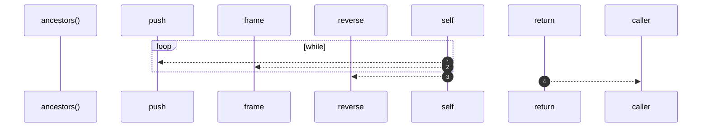

# `robby__site/src/viewer/ancestors`

[Self-model](../../../README.md) · [robby__site/src/viewer](index.md)

| | |
|---|---|
| kind | `code.function` |
| location | [`apps/site/src/viewer.ts:195`](../../../../../apps/site/src/viewer.ts#L195) |
| provenance | extractor · confidence 1.00 |

```rust
function ancestors(id: string): string[] {
  const path: string[] = [];
  let cur: string | null = id;
  while (cur) {
    path.push(cur);
    cur = frame(cur).parent ?? null;
  }
  return path.reverse();
}
```



4 steps · 0 observed · 4 possible only

**Edges**

- calls → [`robby__site/src/viewer/frame`](frame.md)

## References

- calls → [`robby__site/src/viewer`](index.md) — frame

