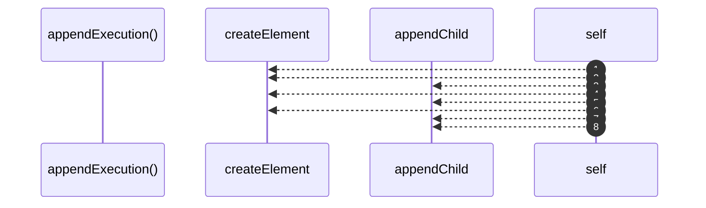

# `robby__site/src/viewer/appendExecution`

[Self-model](../../../README.md) · [robby__site/src/viewer](index.md)

| | |
|---|---|
| kind | `code.function` |
| location | [`apps/site/src/viewer.ts:933`](../../../../../apps/site/src/viewer.ts#L933) |
| provenance | extractor · confidence 1.00 |

```rust
function appendExecution(
  panel: HTMLElement,
  mermaidSrc: string,
  frameId: string,
): void {
  const proc = document.createElement("div");
  proc.className = "process process-execution";
  const heading = document.createElement("h2");
  heading.textContent = "Execution";
  proc.appendChild(heading);
  const summary = document.createElement("div");
  summary.className = "meta";
  summary.textContent = "call path · functions and owning types";
  proc.appendChild(summary);
  const diagram = document.createElement("div");
  diagram.className = "process-mermaid";
  proc.appendChild(diagram);
  panel.appendChild(proc);
  void renderMermaid(diagram, mermaidSrc, `${frameId}-exec`);
}
```



8 steps · 0 observed · 8 possible only

## Referenced by

- calls ← [`robby__site/src/viewer/loadDetail`](loaddetail.md)

