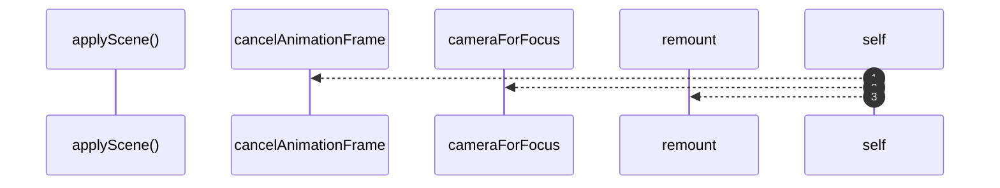

# `robby__site/src/viewer/applyScene`

[Self-model](../../../README.md) · [robby__site/src/viewer](index.md)

| | |
|---|---|
| kind | `code.function` |
| location | [`apps/site/src/viewer.ts:364`](../../../../../apps/site/src/viewer.ts#L364) |
| provenance | extractor · confidence 1.00 |

```rust
function applyScene(next: Scene): void {
  scene = next;
  flying = false;
  window.cancelAnimationFrame(cameraRaf);
  focusId = next.root;
  camera = cameraForFocus(focusId);
  remount();
  void loadDetail(focusId);
}
```



3 steps · 0 observed · 3 possible only

**Edges**

- calls → [`robby__site/src/viewer/cameraForFocus`](cameraforfocus.md)
- calls → [`robby__site/src/viewer/remount`](remount.md)

## References

- calls → [`robby__site/src/viewer`](index.md) — cameraForFocus, remount

## Referenced by

- calls ← [`robby__site/src/viewer/main`](main.md)
- calls ← [`robby__site/src/viewer/reloadFromDisk`](reloadfromdisk.md)
- calls ← [`robby__site/src/viewer/setOrgMode`](setorgmode.md)

