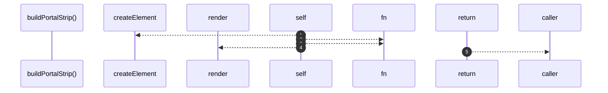

# `robby__site/src/viewer/buildPortalStrip`

[Self-model](../../../README.md) · [robby__site/src/viewer](index.md)

| | |
|---|---|
| kind | `code.function` |
| location | [`apps/site/src/viewer.ts:400`](../../../../../apps/site/src/viewer.ts#L400) |
| provenance | extractor · confidence 1.00 |

```rust
function buildPortalStrip(f: SceneFrame): HTMLElement {
  const strip = document.createElement("div");
  strip.className = "portal-strip";
  let expanded = false;

  const syncFocusClass = (): void => {
    const focusWrap = strip.closest(".frame-wrap");
    focusWrap?.classList.toggle("portals-expanded", expanded);
  };

  const render = (): void => {
    strip.innerHTML = "";
    strip.classList.toggle("is-expanded", expanded);
    syncFocusClass();
    const list = expanded ? f.portals : f.portals.slice(0, PORTAL_PREVIEW);
    for (const portal of list) {
      strip.appendChild(portalButton(portal));
    }
    if (!expanded && f.portals.length > PORTAL_PREVIEW) {
      const more = document.createElement("button");
      more.type = "button";
      more.className = "portal portal-more";
      more.textContent = `+${f.portals.length - PORTAL_PREVIEW} more`;
      more.title = "Show all related views";
      more.addEventListener("click", (e) => {
        e.stopPropagation();
        expanded = true;
        render();
      });
      strip.appendChild(more);
    } else if (expanded && f.portals.length > PORTAL_PREVIEW) {
      const fewer = document.createElement("button");
      fewer.type = "button";
      fewer.className = "portal portal-more";
      fewer.textContent = "Show less";
      fewer.title = "Collapse related views";
      fewer.addEventListener("click", (e) => {
        e.stopPropagation();
        expanded = false;
        render();
      });
      strip.appendChild(fewer);
    }
  };

  render();
  return strip;
}
```



5 steps · 0 observed · 5 possible only

## Referenced by

- calls ← [`robby__site/src/viewer/makeFrameEl`](makeframeel.md)

