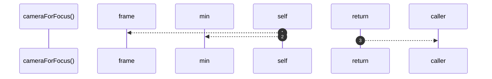

# `robby__site/src/viewer/cameraForFocus`

[Self-model](../../../README.md) · [robby__site/src/viewer](index.md)

| | |
|---|---|
| kind | `code.function` |
| location | [`apps/site/src/viewer.ts:554`](../../../../../apps/site/src/viewer.ts#L554) |
| provenance | extractor · confidence 1.00 |

```rust
function cameraForFocus(id: string): Camera {
  const f = frame(id);
  const vw = window.innerWidth;
  const vh = window.innerHeight;
  const pad = 0.92;
  const scale = Math.min(vw / f.world.w, vh / f.world.h) * pad;
  const cx = f.world.x + f.world.w / 2;
  const cy = f.world.y + f.world.h / 2;
  return {
    scale,
    tx: vw / 2 - cx * scale,
    ty: vh / 2 - cy * scale,
  };
}
```



3 steps · 0 observed · 3 possible only

**Edges**

- calls → [`robby__site/src/viewer/frame`](frame.md)

## References

- calls → [`robby__site/src/viewer`](index.md) — frame

## Referenced by

- calls ← [`robby__site/src/viewer/applyScene`](applyscene.md)
- calls ← [`robby__site/src/viewer/flyTo`](flyto.md)
- calls ← [`robby__site/src/viewer/reloadFromDisk`](reloadfromdisk.md)

