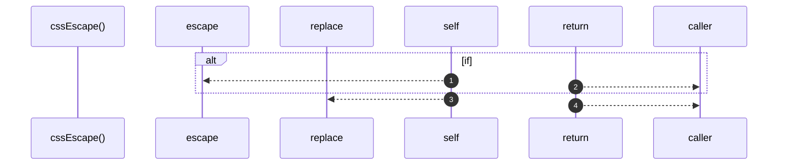

# `robby__site/src/viewer/cssEscape`

[Self-model](../../../README.md) · [robby__site/src/viewer](index.md)

| | |
|---|---|
| kind | `code.function` |
| location | [`apps/site/src/viewer.ts:740`](../../../../../apps/site/src/viewer.ts#L740) |
| provenance | extractor · confidence 1.00 |

```rust
function cssEscape(s: string): string {
  if (window.CSS && typeof CSS.escape === "function") {
    return CSS.escape(s);
  }
  return s.replace(/"/g, '\\"');
}
```



4 steps · 0 observed · 4 possible only

