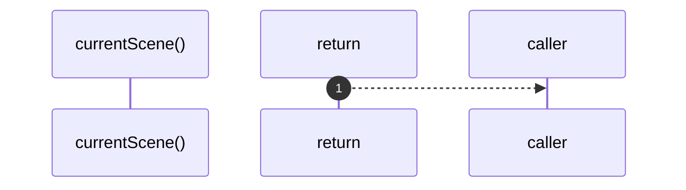

# `robby__site/src/viewer/currentScene`

[Self-model](../../../README.md) · [robby__site/src/viewer](index.md)

| | |
|---|---|
| kind | `code.function` |
| location | [`apps/site/src/viewer.ts:172`](../../../../../apps/site/src/viewer.ts#L172) |
| provenance | extractor · confidence 1.00 |

```rust
function currentScene(): Scene {
  if (!scene) {
    throw new Error("scene is not loaded");
  }
  return scene;
}
```



1 steps · 0 observed · 1 possible only

## Referenced by

- calls ← [`robby__site/src/viewer/frame`](frame.md)

