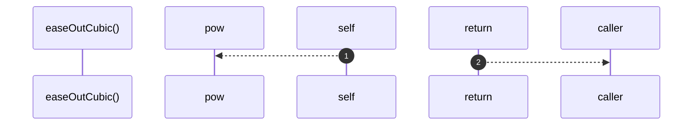

# `robby__site/src/viewer/easeOutCubic`

[Self-model](../../../README.md) · [robby__site/src/viewer](index.md)

| | |
|---|---|
| kind | `code.function` |
| location | [`apps/site/src/viewer.ts:445`](../../../../../apps/site/src/viewer.ts#L445) |
| provenance | extractor · confidence 1.00 |

```rust
function easeOutCubic(t: number): number {
  return 1 - Math.pow(1 - t, 3);
}
```



2 steps · 0 observed · 2 possible only

