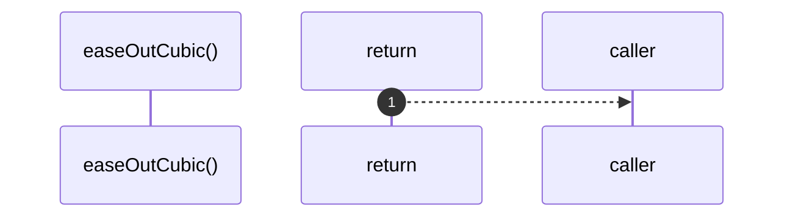

# `robby__site/src/viewer/easeOutCubic`

[Self-model](../../../README.md) · [robby__site/src/viewer](index.md)

| | |
|---|---|
| kind | `code.function` |
| location | [`apps/site/src/viewer.ts:426`](../../../../../apps/site/src/viewer.ts#L426) |
| provenance | extractor · confidence 1.00 |

```rust
function easeOutCubic(t: number) {
  return 1 - (1 - t) ** 3;
}
```



1 steps · 0 observed · 1 possible only

