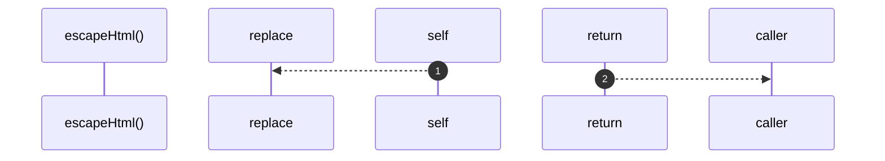

# `robby__site/src/viewer/escapeHtml`

[Self-model](../../../README.md) · [robby__site/src/viewer](index.md)

| | |
|---|---|
| kind | `code.function` |
| location | [`apps/site/src/viewer.ts:650`](../../../../../apps/site/src/viewer.ts#L650) |
| provenance | extractor · confidence 1.00 |

```rust
function escapeHtml(s: string): string {
  return s
    .replace(/&/g, "&amp;")
    .replace(/</g, "&lt;")
    .replace(/>/g, "&gt;")
    .replace(/"/g, "&quot;");
}
```



2 steps · 0 observed · 2 possible only

## Referenced by

- calls ← [`robby__site/src/viewer/portalButton`](portalbutton.md)

