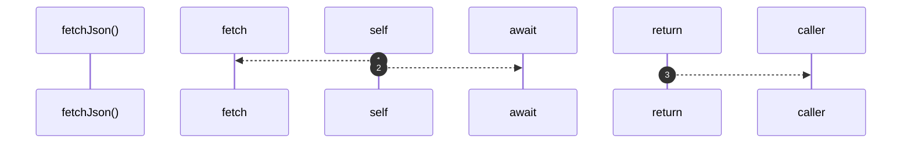

# `robby__site/src/viewer/fetchJson`

[Self-model](../../../README.md) · [robby__site/src/viewer](index.md)

| | |
|---|---|
| kind | `code.function` |
| location | [`apps/site/src/viewer.ts:642`](../../../../../apps/site/src/viewer.ts#L642) |
| provenance | extractor · confidence 1.00 |

```rust
async function fetchJson<T>(path: string): Promise<T> {
  const res = await fetch(path);
  if (!res.ok) {
    throw new Error(`${path}: ${res.status}`);
  }
  return (await res.json()) as T;
}
```



3 steps · 0 observed · 3 possible only

## Referenced by

- calls ← [`robby__site/src/viewer/loadDetail`](loaddetail.md)
- calls ← [`robby__site/src/viewer/main`](main.md)
- calls ← [`robby__site/src/viewer/prefetchEntrypoints`](prefetchentrypoints.md)

