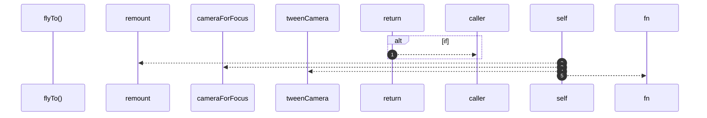

# `robby__site/src/viewer/flyTo`

[Self-model](../../../README.md) · [robby__site/src/viewer](index.md)

| | |
|---|---|
| kind | `code.function` |
| location | [`apps/site/src/viewer.ts:400`](../../../../../apps/site/src/viewer.ts#L400) |
| provenance | extractor · confidence 1.00 |

```rust
function flyTo(id: string) {
  if (!currentScene().frames[id] || id === focusId || flying) {
    return;
  }
  flying = true;
  focusId = id;
  remount();
  const dest = cameraForFocus(focusId);
  tweenCamera(dest, () => {
    // Remount at the settled camera so the focus card paints at native screen
    // resolution instead of keeping a texture from the start of the tween.
    camera = dest;
    remount();
    flying = false;
    void loadDetail(focusId);
  });
}
```



5 steps · 0 observed · 5 possible only

**Edges**

- calls → [`robby__site/src/viewer/remount`](remount.md)
- calls → [`robby__site/src/viewer/cameraForFocus`](cameraforfocus.md)
- calls → [`robby__site/src/viewer/tweenCamera`](tweencamera.md)

## References

- calls → [`robby__site/src/viewer`](index.md) — cameraForFocus, remount, tweenCamera

## Referenced by

- calls ← [`robby__site/src/viewer/zoomOut`](zoomout.md)

