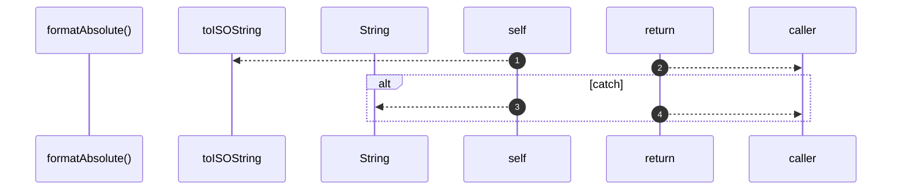

# `robby__site/src/viewer/formatAbsolute`

[Self-model](../../../README.md) · [robby__site/src/viewer](index.md)

| | |
|---|---|
| kind | `code.function` |
| location | [`apps/site/src/viewer.ts:521`](../../../../../apps/site/src/viewer.ts#L521) |
| provenance | extractor · confidence 1.00 |

```rust
function formatAbsolute(ts: number): string {
  try {
    return new Date(ts).toISOString();
  } catch {
    return String(ts);
  }
}
```



4 steps · 0 observed · 4 possible only

