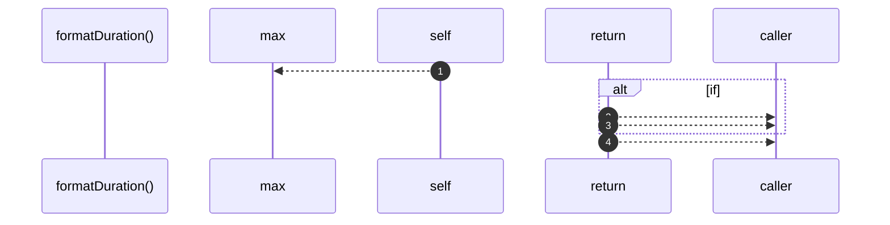

# `robby__site/src/viewer/formatDuration`

[Self-model](../../../README.md) · [robby__site/src/viewer](index.md)

| | |
|---|---|
| kind | `code.function` |
| location | [`apps/site/src/viewer.ts:496`](../../../../../apps/site/src/viewer.ts#L496) |
| provenance | extractor · confidence 1.00 |

```rust
function formatDuration(startedAt: number, finishedAt: number): string {
  const ms = Math.max(0, finishedAt - startedAt);
  if (ms < 1000) {
    return `${ms}ms`;
  }
  if (ms < 60_000) {
    return `${(ms / 1000).toFixed(1)}s`;
  }
  return `${Math.round(ms / 60_000)}m`;
}
```



4 steps · 0 observed · 4 possible only

## Referenced by

- calls ← [`robby__site/src/viewer/renderRunDetail`](renderrundetail.md)

