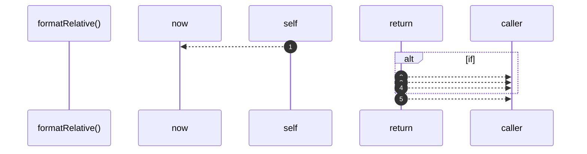

# `robby__site/src/viewer/formatRelative`

[Self-model](../../../README.md) · [robby__site/src/viewer](index.md)

| | |
|---|---|
| kind | `code.function` |
| location | [`apps/site/src/viewer.ts:507`](../../../../../apps/site/src/viewer.ts#L507) |
| provenance | extractor · confidence 1.00 |

```rust
function formatRelative(ts: number): string {
  const delta = Date.now() - ts;
  if (delta < 60_000) {
    return "just now";
  }
  if (delta < 3_600_000) {
    return `${Math.round(delta / 60_000)}m ago`;
  }
  if (delta < 86_400_000) {
    return `${Math.round(delta / 3_600_000)}h ago`;
  }
  return `${Math.round(delta / 86_400_000)}d ago`;
}
```



5 steps · 0 observed · 5 possible only

