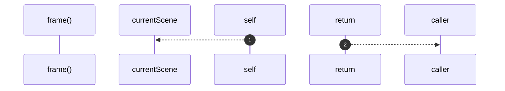

# `robby__site/src/viewer/frame`

[Self-model](../../../README.md) · [robby__site/src/viewer](index.md)

| | |
|---|---|
| kind | `code.function` |
| location | [`apps/site/src/viewer.ts:536`](../../../../../apps/site/src/viewer.ts#L536) |
| provenance | extractor · confidence 1.00 |

```rust
function frame(id: string): SceneFrame {
  const f = currentScene().frames[id];
  if (!f) {
    throw new Error(`missing frame ${id}`);
  }
  return f;
}
```



2 steps · 0 observed · 2 possible only

**Edges**

- calls → [`robby__site/src/viewer/currentScene`](currentscene.md)

## References

- calls → [`robby__site/src/viewer`](index.md) — currentScene

## Referenced by

- calls ← [`robby__site/src/viewer/ancestors`](ancestors.md)
- calls ← [`robby__site/src/viewer/cameraForFocus`](cameraforfocus.md)
- calls ← [`robby__site/src/viewer/frameSafeParent`](framesafeparent.md)
- calls ← [`robby__site/src/viewer/loadDetail`](loaddetail.md)
- calls ← [`robby__site/src/viewer/makeFrameEl`](makeframeel.md)
- calls ← [`robby__site/src/viewer/placeAllFrames`](placeallframes.md)
- calls ← [`robby__site/src/viewer/remount`](remount.md)
- calls ← [`robby__site/src/viewer/screenRectFor`](screenrectfor.md)
- calls ← [`robby__site/src/viewer/zoomOut`](zoomout.md)

