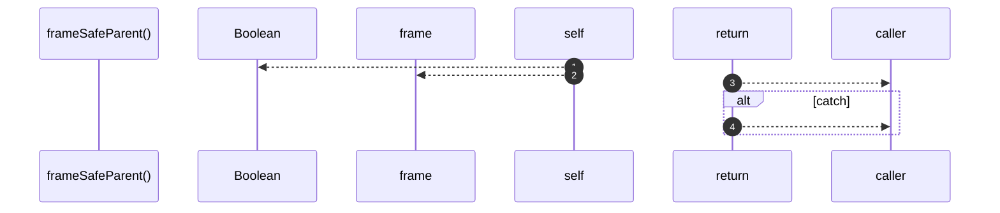

# `robby__site/src/viewer/frameSafeParent`

[Self-model](../../../README.md) · [robby__site/src/viewer](index.md)

| | |
|---|---|
| kind | `code.function` |
| location | [`apps/site/src/viewer.ts:330`](../../../../../apps/site/src/viewer.ts#L330) |
| provenance | extractor · confidence 1.00 |

```rust
function frameSafeParent(): boolean {
  try {
    return Boolean(scene && frame(focusId).parent);
  } catch {
    return false;
  }
}
```



4 steps · 0 observed · 4 possible only

**Edges**

- calls → [`robby__site/src/viewer/frame`](frame.md)

## References

- calls → [`robby__site/src/viewer`](index.md) — frame

