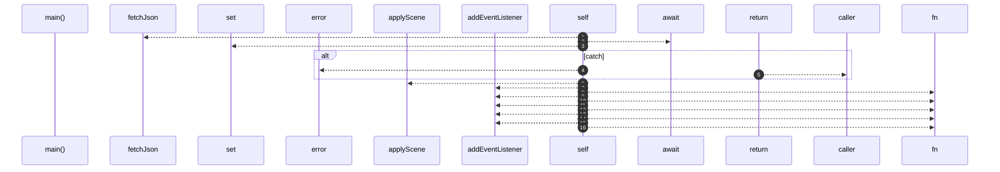
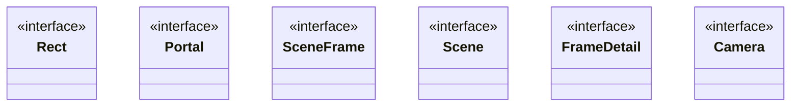
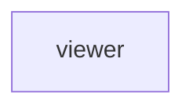

# `robby__site/src/viewer`

[Self-model](../../../README.md) · [robby__site](../../index.md)

| | |
|---|---|
| kind | `code.module` |
| declared at | [`apps/site/src/viewer.ts:1`](../../../../../apps/site/src/viewer.ts#L1) |
| provenance | extractor · confidence 1.00 |
| nodes | 50 |

## Entry



## Types



## Package diagram



## Dependency matrix

| | viewer |
|---|---:|
| **viewer** | · |

## Comments

- `apps/site/src/viewer.ts:15:1` (block, `robby__site/src/viewer/Rect`): "* * Fields this file reads. The JSON is whatever `Scene` and `FrameDetail` * in robby-render serialize; unused fields s…"
  ```
  interface Rect {
    x: number;
    y: number;
    w: number;
    h: number;
  }
  ```
- `apps/site/src/viewer.ts:1:1` (block, `robby__site/src/viewer/Rect`): "* * Prezi-style camera over the Robby scene (flat world coordinates). * * Loads `scene.json` and lazy `frames/<id>.json…"
  ```
  interface Rect {
    x: number;
    y: number;
    w: number;
    h: number;
  }
  ```
- `apps/site/src/viewer.ts:212:1` (block, `robby__site/src/viewer/screenRectFromWorld`): "* Absolute screen rect for a frame from its world coordinates + camera."
  ```
  function screenRectFromWorld(f: SceneFrame, cam: Camera) {
    return {
      x: cam.tx + f.world.x * cam.scale,
      y: cam.ty + f.world.y * cam.scale,
      w: Math.max(f.world.w * cam.scale, 1),
      h: Math.max(f.world.h * cam.scale, 1),
    };
  }
  ```
- `apps/site/src/viewer.ts:222:1` (block, `robby__site/src/viewer/screenRectFor`): "* * Children of the focused frame are placed from `local_in_parent` into the * parent's screen box. Nested world intege…"
  ```
  function screenRectFor(f: SceneFrame, cam: Camera) {
    if (f.parent === focusId && f.local_in_parent && scene) {
      const parent = screenRectFromWorld(frame(focusId), cam);
      const loc = f.local_in_parent;
      const { w, h } = scene.canvas;
      return {
        x: parent.x + (loc.x / w) * parent.w,
        y: parent.y + (loc.y / h) * parent.h,
        w: Math.max((loc.w / w) * parent.w, 1),
        h: Math.max((loc.h / h) * parent.h, 1),
      };
    }
    return screenRectFromWorld(f, cam);
  }
  ```
- `apps/site/src/viewer.ts:252:3` (line, `robby__site/src/viewer/remount`): "Only top-level world cards (the focus). Children live in the body's grid."
  ```
  function remount() {
    worldEl.innerHTML = "";
    const focus = frame(focusId);
    const focusEl = makeFrameEl(focusId, true, false);
    worldEl.appendChild(focusEl);
  
    // Contained nodes sit in a scrollable grid inside the focus body so they can
    // keep a readable minimum size instead of shrinking to fit.
    if (focus.children.length > 0) {
      const body = focusEl.querySelector(".frame-body");
      if (body) {
        const grid = document.createElement("div");
        grid.className = "child-grid";
        for (const childId of focus.children) {
          grid.appendChild(makeFrameEl(childId, false, false));
        }
        body.appendChild(grid);
      }
    }
  
    placeAllFrames();
    updateChrome();
  }
  ```
- `apps/site/src/viewer.ts:268:3` (line, `robby__site/src/viewer/portalButton`): "Contained nodes sit in a scrollable grid inside the focus body so they can"
  ```
  function portalButton(portal: Portal) {
    const btn = document.createElement("button");
    btn.type = "button";
    btn.className = `portal${portal.target ? "" : " unresolved"}`;
    btn.innerHTML = `<span class="pk">${escapeHtml(portal.kind_label)}</span>${escapeHtml(portal.label)}`;
    btn.title = portal.target_name || portal.label;
    if (portal.target) {
      const target = portal.target;
      btn.addEventListener("click", (e) => {
        e.stopPropagation();
        flyTo(target);
      });
    }
    return btn;
  }
  ```
- `apps/site/src/viewer.ts:269:3` (line, `robby__site/src/viewer/portalButton`): "keep a readable minimum size instead of shrinking to fit."
  ```
  function portalButton(portal: Portal) {
    const btn = document.createElement("button");
    btn.type = "button";
    btn.className = `portal${portal.target ? "" : " unresolved"}`;
    btn.innerHTML = `<span class="pk">${escapeHtml(portal.kind_label)}</span>${escapeHtml(portal.label)}`;
    btn.title = portal.target_name || portal.label;
    if (portal.target) {
      const target = portal.target;
      btn.addEventListener("click", (e) => {
        e.stopPropagation();
        flyTo(target);
      });
    }
    return btn;
  }
  ```
- `apps/site/src/viewer.ts:382:3` (line, `robby__site/src/viewer/flyTo`): "Portals only on the focused frame. Child previews stay as clean cards so"
  ```
  function flyTo(id: string) {
    if (!currentScene().frames[id] || id === focusId || flying) {
      return;
    }
    flying = true;
    focusId = id;
    remount();
    const dest = cameraForFocus(focusId);
    tweenCamera(dest, () => {
      // Remount at the settled camera so the focus card paints at native screen
      // resolution instead of keeping a texture from the start of the tween.
      camera = dest;
      remount();
      flying = false;
      void loadDetail(focusId);
    });
  }
  ```
- `apps/site/src/viewer.ts:383:3` (line, `robby__site/src/viewer/flyTo`): "dozens of "calls from …" chips don't paint over the sibling grid."
  ```
  function flyTo(id: string) {
    if (!currentScene().frames[id] || id === focusId || flying) {
      return;
    }
    flying = true;
    focusId = id;
    remount();
    const dest = cameraForFocus(focusId);
    tweenCamera(dest, () => {
      // Remount at the settled camera so the focus card paints at native screen
      // resolution instead of keeping a texture from the start of the tween.
      camera = dest;
      remount();
      flying = false;
      void loadDetail(focusId);
    });
  }
  ```
- `apps/site/src/viewer.ts:409:5` (line, `robby__site/src/viewer/zoomOut`): "Remount at the settled camera so the focus card paints at native screen"
  ```
  function zoomOut() {
    const parent = frame(focusId).parent;
    if (!parent) {
      return;
    }
    flyTo(parent);
  }
  ```
- `apps/site/src/viewer.ts:410:5` (line, `robby__site/src/viewer/zoomOut`): "resolution instead of keeping a texture from the start of the tween."
  ```
  function zoomOut() {
    const parent = frame(focusId).parent;
    if (!parent) {
      return;
    }
    flyTo(parent);
  }
  ```
- `apps/site/src/viewer.ts:481:3` (line, `robby__site/src/viewer/appendExecution`): "Containers keep the child grid — inject execution above it."
  ```
  function appendExecution(panel: HTMLElement, mermaidSrc: string, frameId: string) {
    const proc = document.createElement("div");
    proc.className = "process process-execution";
    const heading = document.createElement("h2");
    heading.textContent = "Execution";
    proc.appendChild(heading);
    const summary = document.createElement("div");
    summary.className = "meta";
    summary.textContent = "call path · functions and owning types";
    proc.appendChild(summary);
    const diagram = document.createElement("div");
    diagram.className = "process-mermaid";
    proc.appendChild(diagram);
    panel.appendChild(proc);
    void renderMermaid(diagram, mermaidSrc, `${frameId}-exec`);
  }
  ```
## Items

| Item | Kind | Steps | Location |
|---|---|---:|---|
| [`Rect`](rect.md) | `code.interface` | — | `apps/site/src/viewer.ts:20:1` |
| [`Portal`](portal.md) | `code.interface` | — | `apps/site/src/viewer.ts:27:1` |
| [`SceneFrame`](sceneframe.md) | `code.interface` | — | `apps/site/src/viewer.ts:34:1` |
| [`Scene`](scene.md) | `code.interface` | — | `apps/site/src/viewer.ts:45:1` |
| [`FrameDetail`](framedetail.md) | `code.interface` | — | `apps/site/src/viewer.ts:51:1` |
| [`Camera`](camera.md) | `code.interface` | — | `apps/site/src/viewer.ts:63:1` |
| [`OrgMode`](orgmode.md) | `code.type_alias` | — | `apps/site/src/viewer.ts:80:1` |
| [`main`](main.md) | `code.function` | 16 | `apps/site/src/viewer.ts:98:1` |
| [`prefetchEntrypoints`](prefetchentrypoints.md) | `code.function` | 5 | `apps/site/src/viewer.ts:127:1` |
| [`setOrgMode`](setorgmode.md) | `code.function` | 9 | `apps/site/src/viewer.ts:141:1` |
| [`applyScene`](applyscene.md) | `code.function` | 3 | `apps/site/src/viewer.ts:162:1` |
| [`currentScene`](currentscene.md) | `code.function` | 1 | `apps/site/src/viewer.ts:172:1` |
| [`frame`](frame.md) | `code.function` | 2 | `apps/site/src/viewer.ts:179:1` |
| [`ancestors`](ancestors.md) | `code.function` | 4 | `apps/site/src/viewer.ts:187:1` |
| [`cameraForFocus`](cameraforfocus.md) | `code.function` | 3 | `apps/site/src/viewer.ts:197:1` |
| [`screenRectFromWorld`](screenrectfromworld.md) | `code.function` | 1 | `apps/site/src/viewer.ts:213:1` |
| [`screenRectFor`](screenrectfor.md) | `code.function` | 5 | `apps/site/src/viewer.ts:227:1` |
| [`placeFrame`](placeframe.md) | `code.function` | 1 | `apps/site/src/viewer.ts:242:1` |
| [`placeAllFrames`](placeallframes.md) | `code.function` | 2 | `apps/site/src/viewer.ts:251:1` |
| [`remount`](remount.md) | `code.function` | 10 | `apps/site/src/viewer.ts:262:1` |
| [`portalButton`](portalbutton.md) | `code.function` | 4 | `apps/site/src/viewer.ts:288:1` |
| [`buildPortalStrip`](buildportalstrip.md) | `code.function` | 5 | `apps/site/src/viewer.ts:304:1` |
| [`makeFrameEl`](makeframeel.md) | `code.function` | 15 | `apps/site/src/viewer.ts:353:1` |
| [`flyTo`](flyto.md) | `code.function` | 5 | `apps/site/src/viewer.ts:400:1` |
| [`zoomOut`](zoomout.md) | `code.function` | 3 | `apps/site/src/viewer.ts:418:1` |
| [`easeOutCubic`](easeoutcubic.md) | `code.function` | 1 | `apps/site/src/viewer.ts:426:1` |
| [`tweenCamera`](tweencamera.md) | `code.function` | 4 | `apps/site/src/viewer.ts:430:1` |
| [`updateChrome`](updatechrome.md) | `code.function` | 1 | `apps/site/src/viewer.ts:455:1` |
| [`loadDetail`](loaddetail.md) | `code.function` | 38 | `apps/site/src/viewer.ts:462:1` |
| [`appendExecution`](appendexecution.md) | `code.function` | 8 | `apps/site/src/viewer.ts:562:1` |
| [`loadMermaid`](loadmermaid.md) | `code.function` | 3 | `apps/site/src/viewer.ts:582:1` |
| [`renderMermaid`](rendermermaid.md) | `code.function` | 7 | `apps/site/src/viewer.ts:597:1` |
| [`fetchJson`](fetchjson.md) | `code.function` | 3 | `apps/site/src/viewer.ts:612:1` |
| [`requireElement`](requireelement.md) | `code.function` | 2 | `apps/site/src/viewer.ts:620:1` |
| [`requireButton`](requirebutton.md) | `code.function` | 2 | `apps/site/src/viewer.ts:628:1` |
| [`escapeHtml`](escapehtml.md) | `code.function` | 2 | `apps/site/src/viewer.ts:636:1` |
| [`cssEscape`](cssescape.md) | `code.function` | 4 | `apps/site/src/viewer.ts:644:1` |

