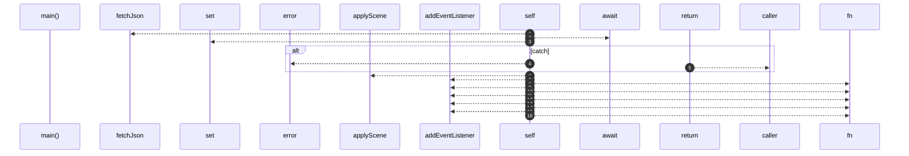
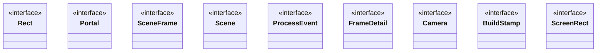
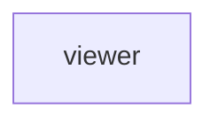

# `robby__site/src/viewer`

[Self-model](../../../README.md) · [robby__site](../../index.md)

| | |
|---|---|
| kind | `code.module` |
| declared at | [`apps/site/src/viewer.ts:1`](../../../../../apps/site/src/viewer.ts#L1) |
| provenance | extractor · confidence 1.00 |
| nodes | 56 |

## Entry



## Types



## Package diagram



## Dependency matrix

| | viewer |
|---|---:|
| **viewer** | · |

## Comments

- `apps/site/src/viewer.ts:155:1` (block, `robby__site/src/viewer/startBuildWatch`): "* Poll `build.json` written by `robby web` / `--watch`; remount when IR site rebuilds."
  ```
  async function startBuildWatch(): Promise<void> {
    const tick = async () => {
      try {
        const stamp = await fetchJson<BuildStamp>(`build.json?t=${Date.now()}`);
        if (lastBuildAt === null) {
          lastBuildAt = stamp.rebuilt_at;
          showWatchBadge(stamp, false);
        } else if (stamp.rebuilt_at !== lastBuildAt) {
          lastBuildAt = stamp.rebuilt_at;
          await reloadFromDisk(stamp);
        }
      } catch {
        // build.json optional until first `robby web` with stamp support
      }
    };
    await tick();
    window.setInterval(() => {
      void tick();
    }, WATCH_POLL_MS);
  }
  ```
- `apps/site/src/viewer.ts:168:7` (line, `robby__site/src/viewer/reloadFromDisk`): "build.json optional until first `robby web` with stamp support"
  ```
  async function reloadFromDisk(stamp: BuildStamp): Promise<void> {
    if (reloading || flying) {
      return;
    }
    reloading = true;
    const keepFocus = focusId;
    const keepOrg = orgMode;
    try {
      detailCache.clear();
      sceneCache.clear();
      const structure = await fetchJson<Scene>(`scene.json?t=${Date.now()}`);
      sceneCache.set("structure", structure);
      try {
        const entrypoints = await fetchJson<Scene>(`scene-entrypoints.json?t=${Date.now()}`);
        sceneCache.set("entrypoints", entrypoints);
      } catch (err) {
        console.error(err);
      }
      orgMode = keepOrg;
      orgStructureBtn.classList.toggle("is-active", keepOrg === "structure");
      orgEntrypointsBtn.classList.toggle("is-active", keepOrg === "entrypoints");
      hintEl.textContent = keepOrg === "entrypoints" ? HINT_ENTRYPOINTS : HINT_STRUCTURE;
      const next = sceneCache.get(keepOrg) ?? structure;
      applyScene(next);
      if (keepFocus && next.frames[keepFocus]) {
        focusId = keepFocus;
        camera = cameraForFocus(focusId);
        remount();
        void loadDetail(focusId);
      }
      showWatchBadge(stamp, true);
    } catch (err) {
      console.error(err);
    } finally {
      reloading = false;
    }
  }
  ```
- `apps/site/src/viewer.ts:1:1` (block, `robby__site/src/viewer/Rect`): "* * Prezi-style camera over the Robby scene (flat world coordinates). * * Loads `scene.json` and lazy `frames/<id>.json…"
  ```
  interface Rect {
    x: number;
    y: number;
    w: number;
    h: number;
  }
  ```
- `apps/site/src/viewer.ts:309:1` (block, `robby__site/src/viewer/screenRectFromWorld`): "* Absolute screen rect for a frame from its world coordinates + camera."
  ```
  function screenRectFromWorld(f: SceneFrame, cam: Camera): ScreenRect {
    return {
      x: cam.tx + f.world.x * cam.scale,
      y: cam.ty + f.world.y * cam.scale,
      w: Math.max(f.world.w * cam.scale, 1),
      h: Math.max(f.world.h * cam.scale, 1),
    };
  }
  ```
- `apps/site/src/viewer.ts:319:1` (block, `robby__site/src/viewer/screenRectFor`): "* * Children of the focused frame are placed from `local_in_parent` into the * parent's screen box. Nested world intege…"
  ```
  function screenRectFor(f: SceneFrame, cam: Camera): ScreenRect {
    if (f.parent === focusId && f.local_in_parent) {
      const parent = screenRectFromWorld(frame(focusId), cam);
      const loc = f.local_in_parent;
      return {
        x: parent.x + (loc.x / CANVAS_W) * parent.w,
        y: parent.y + (loc.y / CANVAS_H) * parent.h,
        w: Math.max((loc.w / CANVAS_W) * parent.w, 1),
        h: Math.max((loc.h / CANVAS_H) * parent.h, 1),
      };
    }
    return screenRectFromWorld(f, cam);
  }
  ```
- `apps/site/src/viewer.ts:348:3` (line, `robby__site/src/viewer/remount`): "Only top-level world cards (the focus). Children live in the body's grid."
  ```
  function remount(): void {
    worldEl.innerHTML = "";
    const focus = frame(focusId);
    const focusEl = makeFrameEl(focusId, true, false);
    worldEl.appendChild(focusEl);
  
    // Contained nodes sit in a scrollable grid inside the focus body so they can
    // keep a readable minimum size instead of shrinking to fit.
    if (focus.children.length > 0) {
      const body = focusEl.querySelector(".frame-body");
      if (body) {
        const grid = document.createElement("div");
        grid.className = "child-grid";
        for (const childId of focus.children) {
          grid.appendChild(makeFrameEl(childId, false, false));
        }
        body.appendChild(grid);
      }
    }
  
    placeAllFrames();
    updateChrome();
  }
  ```
- `apps/site/src/viewer.ts:362:3` (line, `robby__site/src/viewer/portalButton`): "Contained nodes sit in a scrollable grid inside the focus body so they can"
  ```
  function portalButton(portal: Portal): HTMLButtonElement {
    const btn = document.createElement("button");
    btn.type = "button";
    btn.className = "portal" + (portal.target ? "" : " unresolved");
    btn.innerHTML =
      `<span class="pk">${escapeHtml(portal.kind_label)}</span>` +
      escapeHtml(portal.label);
    btn.title = portal.target_name || portal.label;
    if (portal.target) {
      const target = portal.target;
      btn.addEventListener("click", (e) => {
        e.stopPropagation();
        flyTo(target);
      });
    }
    return btn;
  }
  ```
- `apps/site/src/viewer.ts:363:3` (line, `robby__site/src/viewer/portalButton`): "keep a readable minimum size instead of shrinking to fit."
  ```
  function portalButton(portal: Portal): HTMLButtonElement {
    const btn = document.createElement("button");
    btn.type = "button";
    btn.className = "portal" + (portal.target ? "" : " unresolved");
    btn.innerHTML =
      `<span class="pk">${escapeHtml(portal.kind_label)}</span>` +
      escapeHtml(portal.label);
    btn.title = portal.target_name || portal.label;
    if (portal.target) {
      const target = portal.target;
      btn.addEventListener("click", (e) => {
        e.stopPropagation();
        flyTo(target);
      });
    }
    return btn;
  }
  ```
- `apps/site/src/viewer.ts:483:3` (line, `robby__site/src/viewer/flyTo`): "Portals only on the focused frame. Child previews stay as clean cards so"
  ```
  function flyTo(id: string): void {
    if (!scene!.frames[id] || id === focusId || flying) {
      return;
    }
    flying = true;
    focusId = id;
    remount();
    const dest = cameraForFocus(focusId);
    tweenCamera(dest, () => {
      // Remount at the settled camera so the focus card paints at native screen
      // resolution instead of keeping a texture from the start of the tween.
      camera = dest;
      remount();
      flying = false;
      void loadDetail(focusId);
    });
  }
  ```
- `apps/site/src/viewer.ts:484:3` (line, `robby__site/src/viewer/flyTo`): "dozens of "calls from …" chips don't paint over the sibling grid."
  ```
  function flyTo(id: string): void {
    if (!scene!.frames[id] || id === focusId || flying) {
      return;
    }
    flying = true;
    focusId = id;
    remount();
    const dest = cameraForFocus(focusId);
    tweenCamera(dest, () => {
      // Remount at the settled camera so the focus card paints at native screen
      // resolution instead of keeping a texture from the start of the tween.
      camera = dest;
      remount();
      flying = false;
      void loadDetail(focusId);
    });
  }
  ```
- `apps/site/src/viewer.ts:510:5` (line, `robby__site/src/viewer/zoomOut`): "Remount at the settled camera so the focus card paints at native screen"
  ```
  function zoomOut(): void {
    const parent = frame(focusId).parent;
    if (!parent) {
      return;
    }
    flyTo(parent);
  }
  ```
- `apps/site/src/viewer.ts:511:5` (line, `robby__site/src/viewer/zoomOut`): "resolution instead of keeping a texture from the start of the tween."
  ```
  function zoomOut(): void {
    const parent = frame(focusId).parent;
    if (!parent) {
      return;
    }
    flyTo(parent);
  }
  ```
- `apps/site/src/viewer.ts:582:3` (line, `robby__site/src/viewer/appendExecution`): "Containers keep the child grid — inject execution above it."
  ```
  function appendExecution(
    panel: HTMLElement,
    mermaidSrc: string,
    frameId: string,
  ): void {
    const proc = document.createElement("div");
    proc.className = "process process-execution";
    const heading = document.createElement("h2");
    heading.textContent = "Execution";
    proc.appendChild(heading);
    const summary = document.createElement("div");
    summary.className = "meta";
    summary.textContent = "call path · functions and owning types";
    proc.appendChild(summary);
    const diagram = document.createElement("div");
    diagram.className = "process-mermaid";
    proc.appendChild(diagram);
    panel.appendChild(proc);
    void renderMermaid(diagram, mermaidSrc, `${frameId}-exec`);
  }
  ```
- `apps/site/src/viewer.ts:78:3` (block, `robby__site/src/viewer/Camera`): "* Mermaid sequenceDiagram from robby-render (same as Markdown)."
  ```
  interface Camera {
    scale: number;
    tx: number;
    ty: number;
  }
  ```
- `apps/site/src/viewer.ts:80:3` (block, `robby__site/src/viewer/Camera`): "* Path-level Calls sequence (functions + owning types)."
  ```
  interface Camera {
    scale: number;
    tx: number;
    ty: number;
  }
  ```
## Items

| Item | Kind | Steps | Location |
|---|---|---:|---|
| [`Rect`](rect.md) | `code.interface` | — | `apps/site/src/viewer.ts:17:1` |
| [`Portal`](portal.md) | `code.interface` | — | `apps/site/src/viewer.ts:24:1` |
| [`SceneFrame`](sceneframe.md) | `code.interface` | — | `apps/site/src/viewer.ts:31:1` |
| [`Scene`](scene.md) | `code.interface` | — | `apps/site/src/viewer.ts:45:1` |
| [`ProcessEvent`](processevent.md) | `code.interface` | — | `apps/site/src/viewer.ts:51:1` |
| [`FrameDetail`](framedetail.md) | `code.interface` | — | `apps/site/src/viewer.ts:62:1` |
| [`Camera`](camera.md) | `code.interface` | — | `apps/site/src/viewer.ts:85:1` |
| [`OrgMode`](orgmode.md) | `code.type_alias` | — | `apps/site/src/viewer.ts:91:1` |
| [`BuildStamp`](buildstamp.md) | `code.interface` | — | `apps/site/src/viewer.ts:93:1` |
| [`main`](main.md) | `code.function` | 16 | `apps/site/src/viewer.ts:124:1` |
| [`startBuildWatch`](startbuildwatch.md) | `code.function` | 5 | `apps/site/src/viewer.ts:156:1` |
| [`reloadFromDisk`](reloadfromdisk.md) | `code.function` | 18 | `apps/site/src/viewer.ts:177:1` |
| [`showWatchBadge`](showwatchbadge.md) | `code.function` | 0 | `apps/site/src/viewer.ts:215:1` |
| [`prefetchEntrypoints`](prefetchentrypoints.md) | `code.function` | 5 | `apps/site/src/viewer.ts:224:1` |
| [`setOrgMode`](setorgmode.md) | `code.function` | 9 | `apps/site/src/viewer.ts:238:1` |
| [`applyScene`](applyscene.md) | `code.function` | 3 | `apps/site/src/viewer.ts:259:1` |
| [`frame`](frame.md) | `code.function` | 1 | `apps/site/src/viewer.ts:269:1` |
| [`ancestors`](ancestors.md) | `code.function` | 4 | `apps/site/src/viewer.ts:277:1` |
| [`cameraForFocus`](cameraforfocus.md) | `code.function` | 3 | `apps/site/src/viewer.ts:287:1` |
| [`ScreenRect`](screenrect.md) | `code.interface` | — | `apps/site/src/viewer.ts:302:1` |
| [`screenRectFromWorld`](screenrectfromworld.md) | `code.function` | 1 | `apps/site/src/viewer.ts:310:1` |
| [`screenRectFor`](screenrectfor.md) | `code.function` | 5 | `apps/site/src/viewer.ts:324:1` |
| [`placeFrame`](placeframe.md) | `code.function` | 1 | `apps/site/src/viewer.ts:338:1` |
| [`placeAllFrames`](placeallframes.md) | `code.function` | 2 | `apps/site/src/viewer.ts:347:1` |
| [`remount`](remount.md) | `code.function` | 10 | `apps/site/src/viewer.ts:356:1` |
| [`portalButton`](portalbutton.md) | `code.function` | 5 | `apps/site/src/viewer.ts:382:1` |
| [`buildPortalStrip`](buildportalstrip.md) | `code.function` | 5 | `apps/site/src/viewer.ts:400:1` |
| [`makeFrameEl`](makeframeel.md) | `code.function` | 15 | `apps/site/src/viewer.ts:449:1` |
| [`flyTo`](flyto.md) | `code.function` | 5 | `apps/site/src/viewer.ts:501:1` |
| [`zoomOut`](zoomout.md) | `code.function` | 3 | `apps/site/src/viewer.ts:519:1` |
| [`easeOutCubic`](easeoutcubic.md) | `code.function` | 2 | `apps/site/src/viewer.ts:527:1` |
| [`tweenCamera`](tweencamera.md) | `code.function` | 4 | `apps/site/src/viewer.ts:531:1` |
| [`updateChrome`](updatechrome.md) | `code.function` | 1 | `apps/site/src/viewer.ts:556:1` |
| [`loadDetail`](loaddetail.md) | `code.function` | 39 | `apps/site/src/viewer.ts:563:1` |
| [`appendExecution`](appendexecution.md) | `code.function` | 8 | `apps/site/src/viewer.ts:666:1` |
| [`loadMermaid`](loadmermaid.md) | `code.function` | 3 | `apps/site/src/viewer.ts:690:1` |
| [`renderMermaid`](rendermermaid.md) | `code.function` | 7 | `apps/site/src/viewer.ts:705:1` |
| [`fetchJson`](fetchjson.md) | `code.function` | 3 | `apps/site/src/viewer.ts:724:1` |
| [`escapeHtml`](escapehtml.md) | `code.function` | 2 | `apps/site/src/viewer.ts:732:1` |
| [`cssEscape`](cssescape.md) | `code.function` | 4 | `apps/site/src/viewer.ts:740:1` |

