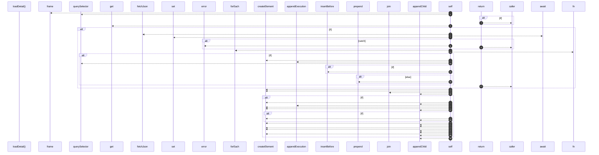

# `robby__site/src/viewer/loadDetail`

[Self-model](../../../README.md) · [robby__site/src/viewer](index.md)

| | |
|---|---|
| kind | `code.function` |
| location | [`apps/site/src/viewer.ts:830`](../../../../../apps/site/src/viewer.ts#L830) |
| provenance | extractor · confidence 1.00 |

```rust
async function loadDetail(id: string): Promise<void> {
  const f = frame(id);
  const host = worldEl.querySelector(`[data-detail-host="${cssEscape(id)}"]`);
  if (!host) {
    return;
  }

  let detail = detailCache.get(id);
  if (!detail) {
    try {
      detail = await fetchJson<FrameDetail>(`frames/${id}.json`);
      detailCache.set(id, detail);
    } catch (err) {
      console.error(err);
      return;
    }
  }

  const isContainer = f.children.length > 0;
  // Containers keep the child grid — inject execution above it.
  if (isContainer) {
    host.querySelectorAll(":scope > .detail").forEach((el) => el.remove());
    if (detail.execution_mermaid) {
      const panel = document.createElement("div");
      panel.className = "detail detail-execution";
      appendExecution(panel, detail.execution_mermaid, id);
      const grid = host.querySelector(".child-grid");
      if (grid) {
        host.insertBefore(panel, grid);
      } else {
        host.prepend(panel);
      }
    }
    return;
  }

  host.innerHTML = "";

  const panel = document.createElement("div");
  panel.className = "detail";

  const meta = document.createElement("div");
  meta.className = "meta";
  meta.textContent = [detail.kind, detail.signature, detail.location, detail.provenance]
    .filter(Boolean)
    .join(" · ");
  panel.appendChild(meta);

  if (detail.docs) {
    const docs = document.createElement("div");
    docs.className = "docs";
    docs.textContent = detail.docs;
    panel.appendChild(docs);
  }

  if (detail.execution_mermaid) {
    appendExecution(panel, detail.execution_mermaid, id);
  }

  if (detail.process_mermaid) {
    const proc = document.createElement("div");
    proc.className = "process";
    const heading = document.createElement("h2");
    heading.textContent = "Process";
    proc.appendChild(heading);
    if (detail.process) {
      const summary = document.createElement("div");
      summary.className = "meta";
      summary.textContent = `${detail.process.step_count} steps · ${detail.process.observed_count} observed`;
      proc.appendChild(summary);
    }
    const diagram = document.createElement("div");
    diagram.className = "process-mermaid";
    proc.appendChild(diagram);
    panel.appendChild(proc);
    void renderMermaid(diagram, detail.process_mermaid, `${id}-process`);
  }

  if (detail.source) {
    const src = document.createElement("div");
    src.className = "source";
    src.innerHTML = `<div class="file">${escapeHtml(detail.source.file)}</div>`;
    const pre = document.createElement("pre");
    pre.textContent = detail.source.text;
    src.appendChild(pre);
    panel.appendChild(src);
  }

  if (
    !detail.execution_mermaid &&
    !detail.process_mermaid &&
    !detail.source &&
    !detail.docs
  ) {
    const empty = document.createElement("div");
    empty.className = "empty-leaf";
    empty.textContent = "No process or source on this node.";
    panel.appendChild(empty);
  }

  host.appendChild(panel);
}
```



39 steps · 0 observed · 39 possible only

**Edges**

- calls → [`robby__site/src/viewer/frame`](frame.md)
- calls → [`robby__site/src/viewer/fetchJson`](fetchjson.md)
- calls → [`robby__site/src/viewer/appendExecution`](appendexecution.md)
- calls → [`robby__site/src/viewer/appendExecution`](appendexecution.md)

## References

- calls → [`robby__site/src/viewer`](index.md) — appendExecution, fetchJson, frame

