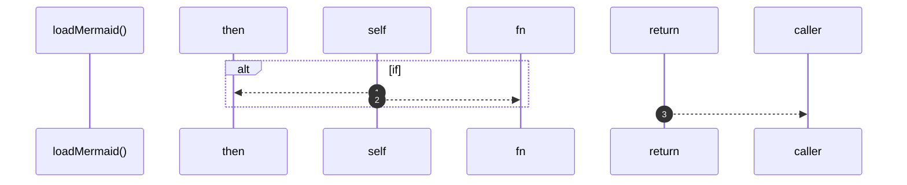

# `robby__site/src/viewer/loadMermaid`

[Self-model](../../../README.md) · [robby__site/src/viewer](index.md)

| | |
|---|---|
| kind | `code.function` |
| location | [`apps/site/src/viewer.ts:608`](../../../../../apps/site/src/viewer.ts#L608) |
| provenance | extractor · confidence 1.00 |

```rust
function loadMermaid(): Promise<typeof import("mermaid")> {
  if (!mermaidReady) {
    mermaidReady = import("mermaid").then((mod) => {
      mod.default.initialize({
        startOnLoad: false,
        theme: "dark",
        securityLevel: "strict",
        flowchart: { htmlLabels: false },
      });
      return mod;
    });
  }
  return mermaidReady;
}
```



3 steps · 0 observed · 3 possible only

## Referenced by

- calls ← [`robby__site/src/viewer/renderMermaid`](rendermermaid.md)

