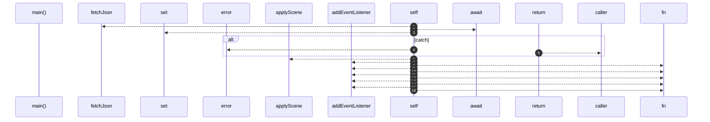

# `robby__site/src/viewer/main`

[Self-model](../../../README.md) · [robby__site/src/viewer](index.md)

| | |
|---|---|
| kind | `code.function` |
| location | [`apps/site/src/viewer.ts:98`](../../../../../apps/site/src/viewer.ts#L98) |
| provenance | extractor · confidence 1.00 |

```rust
async function main() {
  try {
    const structure = await fetchJson<Scene>(ORG_MODES.structure.file);
    sceneCache.set("structure", structure);
    scene = structure;
  } catch (err) {
    worldEl.textContent = "Could not load scene.json. Run `robby web` then serve this app (Vite).";
    console.error(err);
    return;
  }

  applyScene(scene);
  void prefetchEntrypoints();

  zoomOutBtn.addEventListener("click", () => zoomOut());
  orgStructureBtn.addEventListener("click", () => void setOrgMode("structure"));
  orgEntrypointsBtn.addEventListener("click", () => void setOrgMode("entrypoints"));
  window.addEventListener("resize", () => {
    camera = cameraForFocus(focusId);
    placeAllFrames();
  });
  window.addEventListener("keydown", (e) => {
    if (e.key === "Escape" || e.key === "Backspace") {
      e.preventDefault();
      zoomOut();
    }
  });
}
```



16 steps · 0 observed · 16 possible only

**Edges**

- calls → [`robby__site/src/viewer/fetchJson`](fetchjson.md)
- calls → [`robby__site/src/viewer/applyScene`](applyscene.md)

## References

- calls → [`robby__site/src/viewer`](index.md) — applyScene, fetchJson

