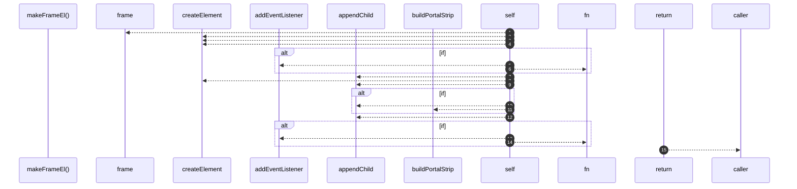

# `robby__site/src/viewer/makeFrameEl`

[Self-model](../../../README.md) · [robby__site/src/viewer](index.md)

| | |
|---|---|
| kind | `code.function` |
| location | [`apps/site/src/viewer.ts:353`](../../../../../apps/site/src/viewer.ts#L353) |
| provenance | extractor · confidence 1.00 |

```rust
function makeFrameEl(id: string, isFocus: boolean, isAncestor: boolean) {
  const f = frame(id);
  const wrap = document.createElement("div");
  wrap.className = `frame-wrap${isFocus ? " is-focus" : ""}${isAncestor ? " is-ancestor" : ""}`;
  wrap.dataset.id = id;

  const inner = document.createElement("div");
  inner.className = `frame${isFocus ? " is-focus" : ""}`;

  const header = document.createElement("div");
  header.className = "frame-header";
  const showFqn = f.fqn && f.fqn !== f.name;
  header.innerHTML = `<span class="kind-chip">${escapeHtml(f.kind_tag)}</span><span class="frame-title">${escapeHtml(f.name)}</span>${showFqn ? `<span class="frame-fqn">${escapeHtml(f.fqn)}</span>` : ""}`;
  if (isFocus && f.parent) {
    const parent = f.parent;
    header.style.cursor = "pointer";
    header.title = "Zoom out";
    header.addEventListener("click", (e) => {
      e.stopPropagation();
      flyTo(parent);
    });
  }
  inner.appendChild(header);

  const body = document.createElement("div");
  body.className = "frame-body";
  body.dataset.detailHost = id;
  inner.appendChild(body);

  // Portals only on the focused frame. Child previews stay as clean cards so
  // dozens of "calls from …" chips don't paint over the sibling grid.
  if (isFocus && f.portals.length > 0) {
    inner.appendChild(buildPortalStrip(f));
  }
  wrap.appendChild(inner);

  if (!isFocus && !isAncestor) {
    wrap.style.cursor = "pointer";
    wrap.addEventListener("click", (e) => {
      e.stopPropagation();
      flyTo(id);
    });
  }

  return wrap;
}
```



15 steps · 0 observed · 15 possible only

**Edges**

- calls → [`robby__site/src/viewer/frame`](frame.md)
- calls → [`robby__site/src/viewer/buildPortalStrip`](buildportalstrip.md)

## References

- calls → [`robby__site/src/viewer`](index.md) — buildPortalStrip, frame

## Referenced by

- calls ← [`robby__site/src/viewer/remount`](remount.md)

