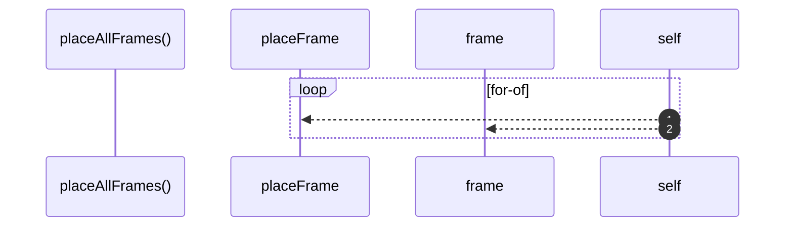

# `robby__site/src/viewer/placeAllFrames`

[Self-model](../../../README.md) · [robby__site/src/viewer](index.md)

| | |
|---|---|
| kind | `code.function` |
| location | [`apps/site/src/viewer.ts:599`](../../../../../apps/site/src/viewer.ts#L599) |
| provenance | extractor · confidence 1.00 |

```rust
function placeAllFrames(): void {
  // Only top-level world cards (the focus). Children live in the body's grid.
  for (const el of worldEl.querySelectorAll<HTMLElement>(":scope > .frame-wrap")) {
    const id = el.dataset.id;
    if (!id) continue;
    placeFrame(el, frame(id), camera);
  }
}
```



2 steps · 0 observed · 2 possible only

**Edges**

- calls → [`robby__site/src/viewer/placeFrame`](placeframe.md)
- calls → [`robby__site/src/viewer/frame`](frame.md)

## References

- calls → [`robby__site/src/viewer`](index.md) — frame, placeFrame

## Referenced by

- calls ← [`robby__site/src/viewer/remount`](remount.md)

