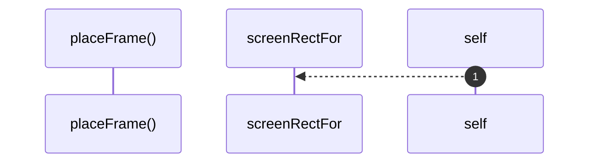

# `robby__site/src/viewer/placeFrame`

[Self-model](../../../README.md) · [robby__site/src/viewer](index.md)

| | |
|---|---|
| kind | `code.function` |
| location | [`apps/site/src/viewer.ts:242`](../../../../../apps/site/src/viewer.ts#L242) |
| provenance | extractor · confidence 1.00 |

```rust
function placeFrame(el: HTMLElement, f: SceneFrame, cam: Camera) {
  const r = screenRectFor(f, cam);
  el.style.width = `${r.w}px`;
  el.style.height = `${r.h}px`;
  el.style.left = `${r.x}px`;
  el.style.top = `${r.y}px`;
  el.style.transform = "none";
}
```



1 steps · 0 observed · 1 possible only

**Edges**

- calls → [`robby__site/src/viewer/screenRectFor`](screenrectfor.md)

## References

- calls → [`robby__site/src/viewer`](index.md) — screenRectFor

## Referenced by

- calls ← [`robby__site/src/viewer/placeAllFrames`](placeallframes.md)

