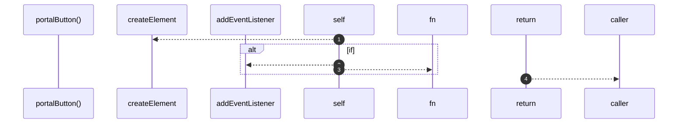

# `robby__site/src/viewer/portalButton`

[Self-model](../../../README.md) · [robby__site/src/viewer](index.md)

| | |
|---|---|
| kind | `code.function` |
| location | [`apps/site/src/viewer.ts:288`](../../../../../apps/site/src/viewer.ts#L288) |
| provenance | extractor · confidence 1.00 |

```rust
function portalButton(portal: Portal) {
  const btn = document.createElement("button");
  btn.type = "button";
  btn.className = `portal${portal.target ? "" : " unresolved"}`;
  btn.innerHTML = `<span class="pk">${escapeHtml(portal.kind_label)}</span>${escapeHtml(portal.label)}`;
  btn.title = portal.target_name || portal.label;
  if (portal.target) {
    const target = portal.target;
    btn.addEventListener("click", (e) => {
      e.stopPropagation();
      flyTo(target);
    });
  }
  return btn;
}
```



4 steps · 0 observed · 4 possible only

