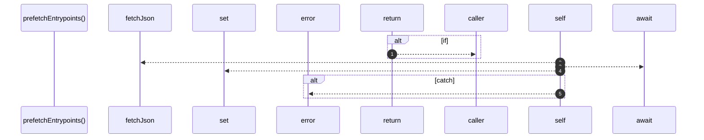

# `robby__site/src/viewer/prefetchEntrypoints`

[Self-model](../../../README.md) · [robby__site/src/viewer](index.md)

| | |
|---|---|
| kind | `code.function` |
| location | [`apps/site/src/viewer.ts:285`](../../../../../apps/site/src/viewer.ts#L285) |
| provenance | extractor · confidence 1.00 |

```rust
async function prefetchEntrypoints(): Promise<void> {
  if (sceneCache.has("entrypoints")) {
    return;
  }
  try {
    const entrypoints = await fetchJson<Scene>("scene-entrypoints.json");
    sceneCache.set("entrypoints", entrypoints);
  } catch (err) {
    console.error(err);
    orgEntrypointsBtn.disabled = true;
    orgEntrypointsBtn.title = "scene-entrypoints.json missing — re-run robby web";
  }
}
```



5 steps · 0 observed · 5 possible only

**Edges**

- calls → [`robby__site/src/viewer/fetchJson`](fetchjson.md)

## References

- calls → [`robby__site/src/viewer`](index.md) — fetchJson

## Referenced by

- calls ← [`robby__site/src/viewer/setOrgMode`](setorgmode.md)

