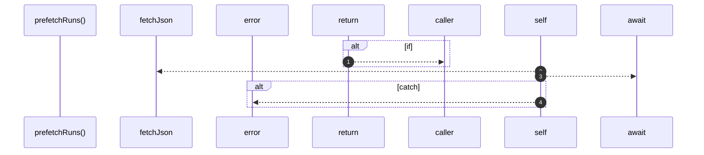

# `robby__site/src/viewer/prefetchRuns`

[Self-model](../../../README.md) · [robby__site/src/viewer](index.md)

| | |
|---|---|
| kind | `code.function` |
| location | [`apps/site/src/viewer.ts:309`](../../../../../apps/site/src/viewer.ts#L309) |
| provenance | extractor · confidence 1.00 |

```rust
async function prefetchRuns(force = false): Promise<void> {
  if (runsIndex && !force) {
    return;
  }
  try {
    runsIndex = await fetchJson<RunsIndex>(`runs/index.json?t=${Date.now()}`);
    orgRunsBtn.disabled = false;
    orgRunsBtn.title = "";
  } catch (err) {
    console.error(err);
    runsIndex = { runs: [] };
    orgRunsBtn.title = "runs/index.json missing — re-run robby web";
  }
}
```



4 steps · 0 observed · 4 possible only

**Edges**

- calls → [`robby__site/src/viewer/fetchJson`](fetchjson.md)

## References

- calls → [`robby__site/src/viewer`](index.md) — fetchJson

## Referenced by

- calls ← [`robby__site/src/viewer/reloadFromDisk`](reloadfromdisk.md)
- calls ← [`robby__site/src/viewer/setOrgMode`](setorgmode.md)

