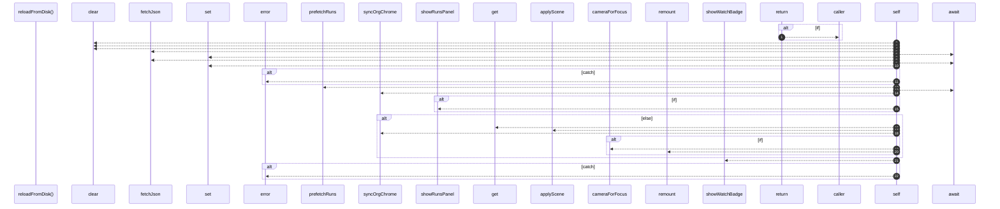

# `robby__site/src/viewer/reloadFromDisk`

[Self-model](../../../README.md) · [robby__site/src/viewer](index.md)

| | |
|---|---|
| kind | `code.function` |
| location | [`apps/site/src/viewer.ts:231`](../../../../../apps/site/src/viewer.ts#L231) |
| provenance | extractor · confidence 1.00 |

```rust
async function reloadFromDisk(stamp: BuildStamp): Promise<void> {
  if (reloading || flying) {
    return;
  }
  reloading = true;
  const keepFocus = focusId;
  const keepOrg = orgMode;
  try {
    detailCache.clear();
    sceneCache.clear();
    runDetailCache.clear();
    const structure = await fetchJson<Scene>(`scene.json?t=${Date.now()}`);
    sceneCache.set("structure", structure);
    try {
      const entrypoints = await fetchJson<Scene>(`scene-entrypoints.json?t=${Date.now()}`);
      sceneCache.set("entrypoints", entrypoints);
    } catch (err) {
      console.error(err);
    }
    await prefetchRuns(true);
    orgMode = keepOrg;
    syncOrgChrome(keepOrg);
    if (keepOrg === "runs") {
      showRunsPanel();
    } else {
      const next =
        sceneCache.get(keepOrg === "entrypoints" ? "entrypoints" : "structure") ??
        structure;
      applyScene(next);
      syncOrgChrome(keepOrg);
      if (keepFocus && next.frames[keepFocus]) {
        focusId = keepFocus;
        camera = cameraForFocus(focusId);
        remount();
        void loadDetail(focusId);
      }
    }
    showWatchBadge(stamp, true);
  } catch (err) {
    console.error(err);
  } finally {
    reloading = false;
  }
}
```



22 steps · 0 observed · 22 possible only

**Edges**

- calls → [`robby__site/src/viewer/fetchJson`](fetchjson.md)
- calls → [`robby__site/src/viewer/fetchJson`](fetchjson.md)
- calls → [`robby__site/src/viewer/prefetchRuns`](prefetchruns.md)
- calls → [`robby__site/src/viewer/syncOrgChrome`](syncorgchrome.md)
- calls → [`robby__site/src/viewer/showRunsPanel`](showrunspanel.md)
- calls → [`robby__site/src/viewer/applyScene`](applyscene.md)
- calls → [`robby__site/src/viewer/syncOrgChrome`](syncorgchrome.md)
- calls → [`robby__site/src/viewer/cameraForFocus`](cameraforfocus.md)
- calls → [`robby__site/src/viewer/remount`](remount.md)
- calls → [`robby__site/src/viewer/showWatchBadge`](showwatchbadge.md)

## References

- calls → [`robby__site/src/viewer`](index.md) — 8 items

