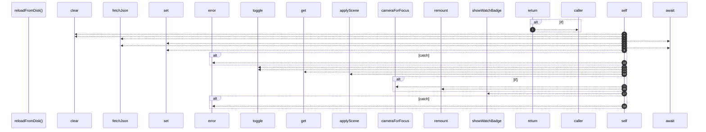

# `robby__site/src/viewer/reloadFromDisk`

[Self-model](../../../README.md) · [robby__site/src/viewer](index.md)

| | |
|---|---|
| kind | `code.function` |
| location | [`apps/site/src/viewer.ts:177`](../../../../../apps/site/src/viewer.ts#L177) |
| provenance | extractor · confidence 1.00 |

```rust
async function reloadFromDisk(stamp: BuildStamp): Promise<void> {
  if (reloading || flying) {
    return;
  }
  reloading = true;
  const keepFocus = focusId;
  const keepOrg = orgMode;
  try {
    detailCache.clear();
    sceneCache.clear();
    const structure = await fetchJson<Scene>(`scene.json?t=${Date.now()}`);
    sceneCache.set("structure", structure);
    try {
      const entrypoints = await fetchJson<Scene>(`scene-entrypoints.json?t=${Date.now()}`);
      sceneCache.set("entrypoints", entrypoints);
    } catch (err) {
      console.error(err);
    }
    orgMode = keepOrg;
    orgStructureBtn.classList.toggle("is-active", keepOrg === "structure");
    orgEntrypointsBtn.classList.toggle("is-active", keepOrg === "entrypoints");
    hintEl.textContent = keepOrg === "entrypoints" ? HINT_ENTRYPOINTS : HINT_STRUCTURE;
    const next = sceneCache.get(keepOrg) ?? structure;
    applyScene(next);
    if (keepFocus && next.frames[keepFocus]) {
      focusId = keepFocus;
      camera = cameraForFocus(focusId);
      remount();
      void loadDetail(focusId);
    }
    showWatchBadge(stamp, true);
  } catch (err) {
    console.error(err);
  } finally {
    reloading = false;
  }
}
```



18 steps · 0 observed · 18 possible only

**Edges**

- calls → [`robby__site/src/viewer/fetchJson`](fetchjson.md)
- calls → [`robby__site/src/viewer/fetchJson`](fetchjson.md)
- calls → [`robby__site/src/viewer/applyScene`](applyscene.md)
- calls → [`robby__site/src/viewer/cameraForFocus`](cameraforfocus.md)
- calls → [`robby__site/src/viewer/remount`](remount.md)
- calls → [`robby__site/src/viewer/showWatchBadge`](showwatchbadge.md)

## References

- calls → [`robby__site/src/viewer`](index.md) — 5 items

