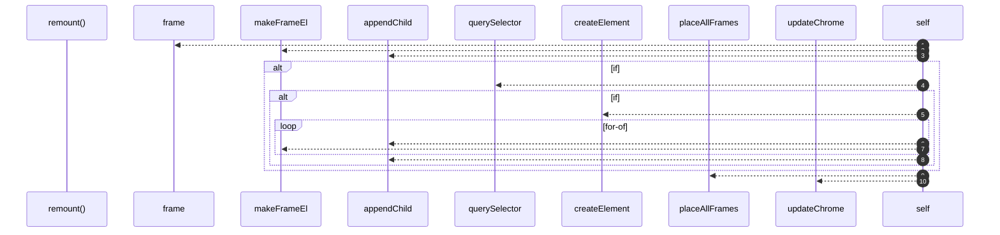

# `robby__site/src/viewer/remount`

[Self-model](../../../README.md) · [robby__site/src/viewer](index.md)

| | |
|---|---|
| kind | `code.function` |
| location | [`apps/site/src/viewer.ts:262`](../../../../../apps/site/src/viewer.ts#L262) |
| provenance | extractor · confidence 1.00 |

```rust
function remount() {
  worldEl.innerHTML = "";
  const focus = frame(focusId);
  const focusEl = makeFrameEl(focusId, true, false);
  worldEl.appendChild(focusEl);

  // Contained nodes sit in a scrollable grid inside the focus body so they can
  // keep a readable minimum size instead of shrinking to fit.
  if (focus.children.length > 0) {
    const body = focusEl.querySelector(".frame-body");
    if (body) {
      const grid = document.createElement("div");
      grid.className = "child-grid";
      for (const childId of focus.children) {
        grid.appendChild(makeFrameEl(childId, false, false));
      }
      body.appendChild(grid);
    }
  }

  placeAllFrames();
  updateChrome();
}
```



10 steps · 0 observed · 10 possible only

**Edges**

- calls → [`robby__site/src/viewer/frame`](frame.md)
- calls → [`robby__site/src/viewer/makeFrameEl`](makeframeel.md)
- calls → [`robby__site/src/viewer/makeFrameEl`](makeframeel.md)
- calls → [`robby__site/src/viewer/placeAllFrames`](placeallframes.md)
- calls → [`robby__site/src/viewer/updateChrome`](updatechrome.md)

## References

- calls → [`robby__site/src/viewer`](index.md) — frame, makeFrameEl, placeAllFrames, updateChrome

## Referenced by

- calls ← [`robby__site/src/viewer/applyScene`](applyscene.md)
- calls ← [`robby__site/src/viewer/flyTo`](flyto.md)

