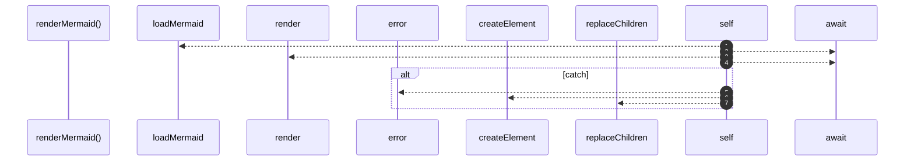

# `robby__site/src/viewer/renderMermaid`

[Self-model](../../../README.md) · [robby__site/src/viewer](index.md)

| | |
|---|---|
| kind | `code.function` |
| location | [`apps/site/src/viewer.ts:957`](../../../../../apps/site/src/viewer.ts#L957) |
| provenance | extractor · confidence 1.00 |

```rust
async function renderMermaid(
  host: HTMLElement,
  definition: string,
  frameId: string,
): Promise<void> {
  try {
    const { default: mermaid } = await loadMermaid();
    const renderId = `mmd-${frameId.replace(/[^a-zA-Z0-9_-]/g, "_")}-${++mermaidSeq}`;
    const { svg } = await mermaid.render(renderId, definition);
    host.innerHTML = svg;
  } catch (err) {
    console.error(err);
    const pre = document.createElement("pre");
    pre.className = "process-mermaid-fallback";
    pre.textContent = definition;
    host.replaceChildren(pre);
  }
}
```



7 steps · 0 observed · 7 possible only

**Edges**

- calls → [`robby__site/src/viewer/loadMermaid`](loadmermaid.md)

## References

- calls → [`robby__site/src/viewer`](index.md) — loadMermaid

