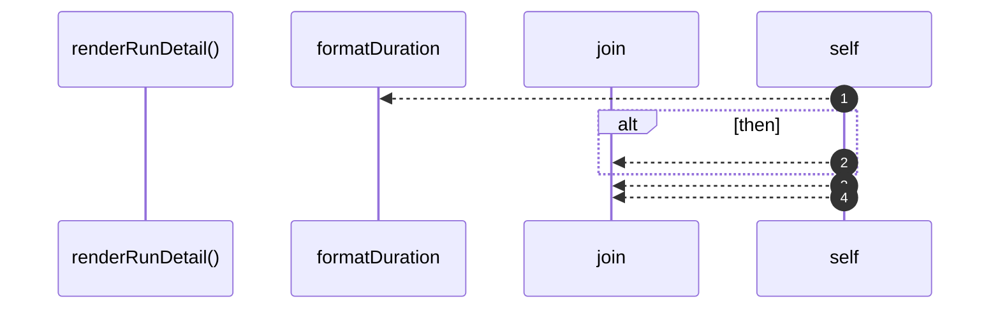

# `robby__site/src/viewer/renderRunDetail`

[Self-model](../../../README.md) · [robby__site/src/viewer](index.md)

| | |
|---|---|
| kind | `code.function` |
| location | [`apps/site/src/viewer.ts:442`](../../../../../apps/site/src/viewer.ts#L442) |
| provenance | extractor · confidence 1.00 |

```rust
function renderRunDetail(detail: RunRecord): void {
  runsDetailEl.hidden = false;
  const duration = formatDuration(detail.started_at, detail.finished_at);
  const stats = detail.stats
    ? Object.entries(detail.stats)
        .map(([k, v]) => `<dt>${escapeHtml(k)}</dt><dd>${escapeHtml(String(v))}</dd>`)
        .join("")
    : "";
  const products = (detail.products ?? [])
    .map((p) => `<li>${escapeHtml(p)}</li>`)
    .join("");
  const stages = (detail.process?.steps ?? [])
    .map(
      (s) =>
        `<li>${escapeHtml(s.from)} → ${escapeHtml(s.to)}` +
        (s.label && s.label !== s.to ? ` · ${escapeHtml(s.label)}` : "") +
        (s.observed ? "" : " (planned)") +
        `</li>`,
    )
    .join("");
  runsDetailEl.innerHTML =
    `<h2>${escapeHtml(detail.recipe)}</h2>` +
    `<div class="meta"><span class="run-status ${statusClass(detail.status)}">${escapeHtml(detail.status)}</span>` +
    ` · ${escapeHtml(detail.run_id)} · ${escapeHtml(duration)}</div>` +
    `<dl class="run-kv">` +
    `<dt>subject</dt><dd>${escapeHtml(detail.subject)}</dd>` +
    `<dt>started</dt><dd>${escapeHtml(formatAbsolute(detail.started_at))}</dd>` +
    `<dt>finished</dt><dd>${escapeHtml(formatAbsolute(detail.finished_at))}</dd>` +
    (detail.exit_code !== undefined
      ? `<dt>exit_code</dt><dd>${escapeHtml(String(detail.exit_code))}</dd>`
      : "") +
    stats +
    `</dl>` +
    (detail.stdout_tail
      ? `<div class="stdout">${escapeHtml(detail.stdout_tail)}</div>`
      : "") +
    (products
      ? `<div class="stages"><h2>Products</h2><ol>${products}</ol></div>`
      : "") +
    (stages
      ? `<div class="stages"><h2>Stages</h2><ol>${stages}</ol></div>`
      : "");
}
```



4 steps · 0 observed · 4 possible only

**Edges**

- calls → [`robby__site/src/viewer/formatDuration`](formatduration.md)

## References

- calls → [`robby__site/src/viewer`](index.md) — formatDuration

## Referenced by

- calls ← [`robby__site/src/viewer/selectRun`](selectrun.md)

