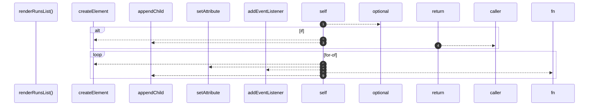

# `robby__site/src/viewer/renderRunsList`

[Self-model](../../../README.md) · [robby__site/src/viewer](index.md)

| | |
|---|---|
| kind | `code.function` |
| location | [`apps/site/src/viewer.ts:394`](../../../../../apps/site/src/viewer.ts#L394) |
| provenance | extractor · confidence 1.00 |

```rust
function renderRunsList(): void {
  runsListEl.innerHTML = "";
  const runs = runsIndex?.runs ?? [];
  if (runs.length === 0) {
    const empty = document.createElement("div");
    empty.className = "runs-empty";
    empty.textContent =
      "No RunRecords yet. Run `robby web` to emit runs/index.json.";
    runsListEl.appendChild(empty);
    return;
  }
  for (const entry of runs) {
    const btn = document.createElement("button");
    btn.type = "button";
    btn.className = "run-row" + (entry.run_id === selectedRunId ? " is-selected" : "");
    btn.setAttribute("role", "listitem");
    btn.innerHTML =
      `<span class="run-status ${statusClass(entry.status)}">${escapeHtml(entry.status)}</span>` +
      `<span class="run-main">` +
      `<span class="run-recipe">${escapeHtml(entry.recipe)}</span>` +
      `<span class="run-subject">${escapeHtml(entry.subject)}</span>` +
      `</span>` +
      `<span class="run-time">${escapeHtml(formatDuration(entry.started_at, entry.finished_at))} · ${escapeHtml(formatRelative(entry.finished_at))}</span>`;
    btn.addEventListener("click", () => {
      void selectRun(entry.run_id);
    });
    runsListEl.appendChild(btn);
  }
}
```



9 steps · 0 observed · 9 possible only

## Referenced by

- calls ← [`robby__site/src/viewer/selectRun`](selectrun.md)
- calls ← [`robby__site/src/viewer/showRunsPanel`](showrunspanel.md)

