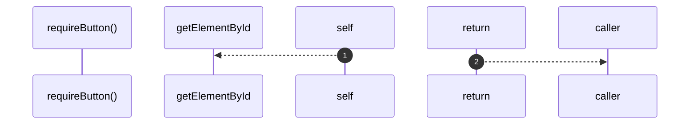

# `robby__site/src/viewer/requireButton`

[Self-model](../../../README.md) · [robby__site/src/viewer](index.md)

| | |
|---|---|
| kind | `code.function` |
| location | [`apps/site/src/viewer.ts:628`](../../../../../apps/site/src/viewer.ts#L628) |
| provenance | extractor · confidence 1.00 |

```rust
function requireButton(id: string) {
  const el = document.getElementById(id);
  if (!(el instanceof HTMLButtonElement)) {
    throw new Error(`missing button #${id}`);
  }
  return el;
}
```



2 steps · 0 observed · 2 possible only

