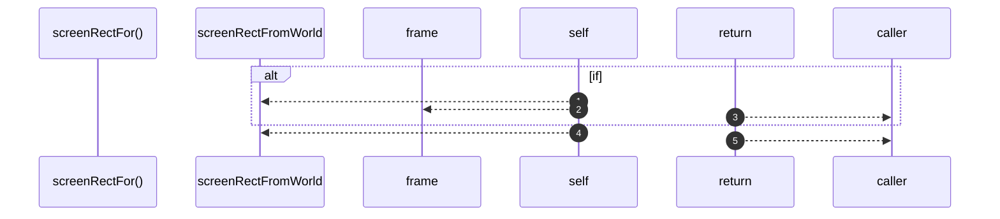

# `robby__site/src/viewer/screenRectFor`

[Self-model](../../../README.md) · [robby__site/src/viewer](index.md)

| | |
|---|---|
| kind | `code.function` |
| location | [`apps/site/src/viewer.ts:227`](../../../../../apps/site/src/viewer.ts#L227) |
| provenance | extractor · confidence 1.00 |

> *
>  * Children of the focused frame are placed from `local_in_parent` into the
>  * parent's screen box. Nested world integers collapse to 1×1 and stack; the
>  * local grid on the 1600×1000 canvas does not.

```rust
function screenRectFor(f: SceneFrame, cam: Camera) {
  if (f.parent === focusId && f.local_in_parent && scene) {
    const parent = screenRectFromWorld(frame(focusId), cam);
    const loc = f.local_in_parent;
    const { w, h } = scene.canvas;
    return {
      x: parent.x + (loc.x / w) * parent.w,
      y: parent.y + (loc.y / h) * parent.h,
      w: Math.max((loc.w / w) * parent.w, 1),
      h: Math.max((loc.h / h) * parent.h, 1),
    };
  }
  return screenRectFromWorld(f, cam);
}
```



5 steps · 0 observed · 5 possible only

**Edges**

- calls → [`robby__site/src/viewer/screenRectFromWorld`](screenrectfromworld.md)
- calls → [`robby__site/src/viewer/frame`](frame.md)
- calls → [`robby__site/src/viewer/screenRectFromWorld`](screenrectfromworld.md)

## References

- calls → [`robby__site/src/viewer`](index.md) — frame, screenRectFromWorld

## Referenced by

- calls ← [`robby__site/src/viewer/placeFrame`](placeframe.md)

