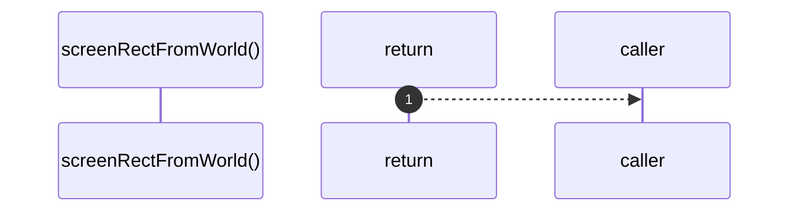

# `robby__site/src/viewer/screenRectFromWorld`

[Self-model](../../../README.md) · [robby__site/src/viewer](index.md)

| | |
|---|---|
| kind | `code.function` |
| location | [`apps/site/src/viewer.ts:213`](../../../../../apps/site/src/viewer.ts#L213) |
| provenance | extractor · confidence 1.00 |

> * Absolute screen rect for a frame from its world coordinates + camera.

```rust
function screenRectFromWorld(f: SceneFrame, cam: Camera) {
  return {
    x: cam.tx + f.world.x * cam.scale,
    y: cam.ty + f.world.y * cam.scale,
    w: Math.max(f.world.w * cam.scale, 1),
    h: Math.max(f.world.h * cam.scale, 1),
  };
}
```



1 steps · 0 observed · 1 possible only

## Referenced by

- calls ← [`robby__site/src/viewer/screenRectFor`](screenrectfor.md)

