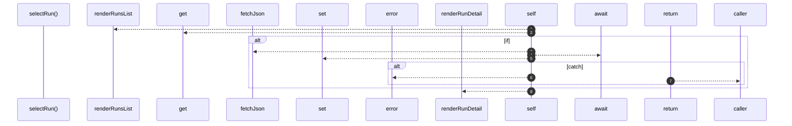

# `robby__site/src/viewer/selectRun`

[Self-model](../../../README.md) · [robby__site/src/viewer](index.md)

| | |
|---|---|
| kind | `code.function` |
| location | [`apps/site/src/viewer.ts:424`](../../../../../apps/site/src/viewer.ts#L424) |
| provenance | extractor · confidence 1.00 |

```rust
async function selectRun(runId: string): Promise<void> {
  selectedRunId = runId;
  renderRunsList();
  let detail = runDetailCache.get(runId);
  if (!detail) {
    try {
      detail = await fetchJson<RunRecord>(`runs/${encodeURIComponent(runId)}.json?t=${Date.now()}`);
      runDetailCache.set(runId, detail);
    } catch (err) {
      console.error(err);
      runsDetailEl.hidden = false;
      runsDetailEl.innerHTML = `<div class="runs-empty">Could not load runs/${escapeHtml(runId)}.json</div>`;
      return;
    }
  }
  renderRunDetail(detail);
}
```



8 steps · 0 observed · 8 possible only

**Edges**

- calls → [`robby__site/src/viewer/renderRunsList`](renderrunslist.md)
- calls → [`robby__site/src/viewer/fetchJson`](fetchjson.md)
- calls → [`robby__site/src/viewer/renderRunDetail`](renderrundetail.md)

## References

- calls → [`robby__site/src/viewer`](index.md) — fetchJson, renderRunDetail, renderRunsList

