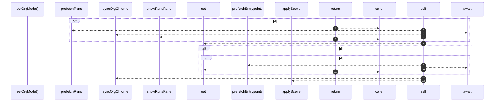

# `robby__site/src/viewer/setOrgMode`

[Self-model](../../../README.md) · [robby__site/src/viewer](index.md)

| | |
|---|---|
| kind | `code.function` |
| location | [`apps/site/src/viewer.ts:346`](../../../../../apps/site/src/viewer.ts#L346) |
| provenance | extractor · confidence 1.00 |

```rust
async function setOrgMode(next: OrgMode): Promise<void> {
  if (next === orgMode || flying) {
    return;
  }
  if (next === "runs") {
    await prefetchRuns();
    orgMode = "runs";
    syncOrgChrome("runs");
    showRunsPanel();
    return;
  }
  let cached = sceneCache.get(next);
  if (!cached) {
    if (next === "entrypoints") {
      await prefetchEntrypoints();
      cached = sceneCache.get(next);
    }
    if (!cached) {
      return;
    }
  }
  orgMode = next;
  syncOrgChrome(next);
  applyScene(cached);
}
```



13 steps · 0 observed · 13 possible only

**Edges**

- calls → [`robby__site/src/viewer/prefetchRuns`](prefetchruns.md)
- calls → [`robby__site/src/viewer/syncOrgChrome`](syncorgchrome.md)
- calls → [`robby__site/src/viewer/showRunsPanel`](showrunspanel.md)
- calls → [`robby__site/src/viewer/prefetchEntrypoints`](prefetchentrypoints.md)
- calls → [`robby__site/src/viewer/syncOrgChrome`](syncorgchrome.md)
- calls → [`robby__site/src/viewer/applyScene`](applyscene.md)

## References

- calls → [`robby__site/src/viewer`](index.md) — 5 items

