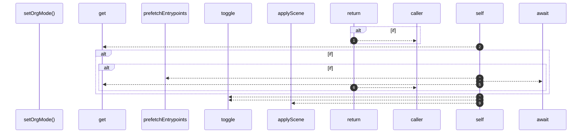

# `robby__site/src/viewer/setOrgMode`

[Self-model](../../../README.md) · [robby__site/src/viewer](index.md)

| | |
|---|---|
| kind | `code.function` |
| location | [`apps/site/src/viewer.ts:156`](../../../../../apps/site/src/viewer.ts#L156) |
| provenance | extractor · confidence 1.00 |

```rust
async function setOrgMode(next: OrgMode): Promise<void> {
  if (next === orgMode || flying) {
    return;
  }
  let cached = sceneCache.get(next);
  if (!cached) {
    if (next === "entrypoints") {
      await prefetchEntrypoints();
      cached = sceneCache.get(next);
    }
    if (!cached) {
      return;
    }
  }
  orgMode = next;
  orgStructureBtn.classList.toggle("is-active", next === "structure");
  orgEntrypointsBtn.classList.toggle("is-active", next === "entrypoints");
  hintEl.textContent = next === "entrypoints" ? HINT_ENTRYPOINTS : HINT_STRUCTURE;
  applyScene(cached);
}
```



9 steps · 0 observed · 9 possible only

**Edges**

- calls → [`robby__site/src/viewer/prefetchEntrypoints`](prefetchentrypoints.md)
- calls → [`robby__site/src/viewer/applyScene`](applyscene.md)

## References

- calls → [`robby__site/src/viewer`](index.md) — applyScene, prefetchEntrypoints

