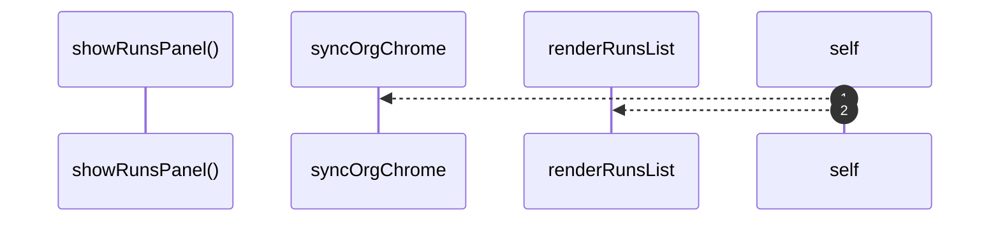

# `robby__site/src/viewer/showRunsPanel`

[Self-model](../../../README.md) · [robby__site/src/viewer](index.md)

| | |
|---|---|
| kind | `code.function` |
| location | [`apps/site/src/viewer.ts:374`](../../../../../apps/site/src/viewer.ts#L374) |
| provenance | extractor · confidence 1.00 |

```rust
function showRunsPanel(): void {
  syncOrgChrome("runs");
  crumbEl.textContent = "Runs";
  renderRunsList();
  if (selectedRunId) {
    void selectRun(selectedRunId);
  } else {
    runsDetailEl.hidden = true;
    runsDetailEl.innerHTML = "";
  }
}
```



2 steps · 0 observed · 2 possible only

**Edges**

- calls → [`robby__site/src/viewer/syncOrgChrome`](syncorgchrome.md)
- calls → [`robby__site/src/viewer/renderRunsList`](renderrunslist.md)

## References

- calls → [`robby__site/src/viewer`](index.md) — renderRunsList, syncOrgChrome

## Referenced by

- calls ← [`robby__site/src/viewer/reloadFromDisk`](reloadfromdisk.md)
- calls ← [`robby__site/src/viewer/setOrgMode`](setorgmode.md)

