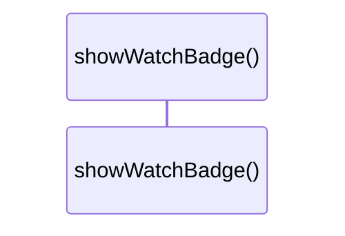

# `robby__site/src/viewer/showWatchBadge`

[Self-model](../../../README.md) · [robby__site/src/viewer](index.md)

| | |
|---|---|
| kind | `code.function` |
| location | [`apps/site/src/viewer.ts:286`](../../../../../apps/site/src/viewer.ts#L286) |
| provenance | extractor · confidence 1.00 |

```rust
function showWatchBadge(stamp: BuildStamp, justRebuilt: boolean): void {
  const nodes = stamp.nodes ?? "?";
  const label = justRebuilt
    ? `IR rebuilt · ${stamp.frames} frames · ${nodes} nodes`
    : `live · ${stamp.frames} frames · ${nodes} nodes`;
  watchBadgeEl.textContent = label;
  watchBadgeEl.hidden = false;
}
```



0 steps · 0 observed · 0 possible only

## Referenced by

- calls ← [`robby__site/src/viewer/reloadFromDisk`](reloadfromdisk.md)

