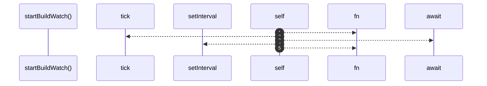

# `robby__site/src/viewer/startBuildWatch`

[Self-model](../../../README.md) · [robby__site/src/viewer](index.md)

| | |
|---|---|
| kind | `code.function` |
| location | [`apps/site/src/viewer.ts:156`](../../../../../apps/site/src/viewer.ts#L156) |
| provenance | extractor · confidence 1.00 |

> * Poll `build.json` written by `robby web` / `--watch`; remount when IR site rebuilds.

```rust
async function startBuildWatch(): Promise<void> {
  const tick = async () => {
    try {
      const stamp = await fetchJson<BuildStamp>(`build.json?t=${Date.now()}`);
      if (lastBuildAt === null) {
        lastBuildAt = stamp.rebuilt_at;
        showWatchBadge(stamp, false);
      } else if (stamp.rebuilt_at !== lastBuildAt) {
        lastBuildAt = stamp.rebuilt_at;
        await reloadFromDisk(stamp);
      }
    } catch {
      // build.json optional until first `robby web` with stamp support
    }
  };
  await tick();
  window.setInterval(() => {
    void tick();
  }, WATCH_POLL_MS);
}
```



5 steps · 0 observed · 5 possible only

