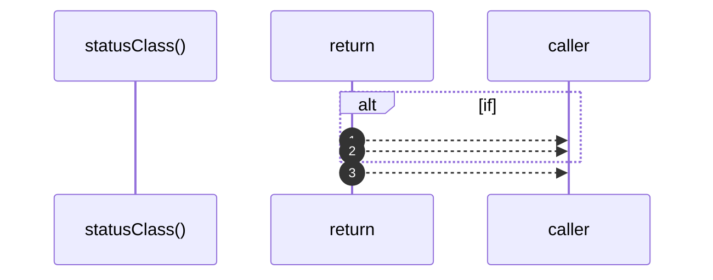

# `robby__site/src/viewer/statusClass`

[Self-model](../../../README.md) · [robby__site/src/viewer](index.md)

| | |
|---|---|
| kind | `code.function` |
| location | [`apps/site/src/viewer.ts:486`](../../../../../apps/site/src/viewer.ts#L486) |
| provenance | extractor · confidence 1.00 |

```rust
function statusClass(status: string): string {
  if (status === "fail" || status === "error") {
    return `is-${status}`;
  }
  if (status === "running" || status === "queued") {
    return `is-${status}`;
  }
  return "is-pass";
}
```



3 steps · 0 observed · 3 possible only

