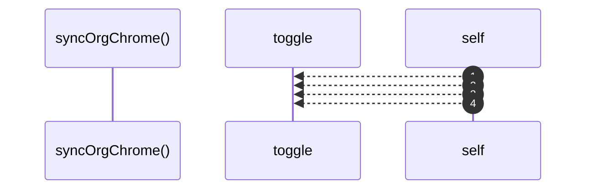

# `robby__site/src/viewer/syncOrgChrome`

[Self-model](../../../README.md) · [robby__site/src/viewer](index.md)

| | |
|---|---|
| kind | `code.function` |
| location | [`apps/site/src/viewer.ts:324`](../../../../../apps/site/src/viewer.ts#L324) |
| provenance | extractor · confidence 1.00 |

```rust
function syncOrgChrome(mode: OrgMode): void {
  orgStructureBtn.classList.toggle("is-active", mode === "structure");
  orgEntrypointsBtn.classList.toggle("is-active", mode === "entrypoints");
  orgRunsBtn.classList.toggle("is-active", mode === "runs");
  if (mode === "runs") {
    hintEl.textContent = HINT_RUNS;
  } else {
    hintEl.textContent = ORG_MODES[mode].hint;
  }
  viewportEl.classList.toggle("runs-open", mode === "runs");
  runsPanelEl.hidden = mode !== "runs";
  zoomOutBtn.disabled = mode === "runs" || !scene || !frameSafeParent();
}
```



4 steps · 0 observed · 4 possible only

## Referenced by

- calls ← [`robby__site/src/viewer/reloadFromDisk`](reloadfromdisk.md)
- calls ← [`robby__site/src/viewer/setOrgMode`](setorgmode.md)
- calls ← [`robby__site/src/viewer/showRunsPanel`](showrunspanel.md)

