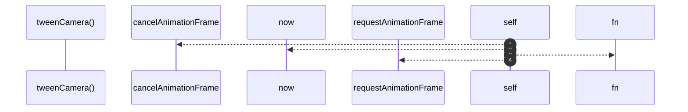

# `robby__site/src/viewer/tweenCamera`

[Self-model](../../../README.md) · [robby__site/src/viewer](index.md)

| | |
|---|---|
| kind | `code.function` |
| location | [`apps/site/src/viewer.ts:783`](../../../../../apps/site/src/viewer.ts#L783) |
| provenance | extractor · confidence 1.00 |

```rust
function tweenCamera(next: Camera, onDone?: () => void): void {
  window.cancelAnimationFrame(cameraRaf);
  const from = { ...camera };
  const start = performance.now();

  const tick = (now: number): void => {
    const t = Math.min(1, (now - start) / TWEEN_MS);
    const e = easeOutCubic(t);
    camera = {
      scale: from.scale + (next.scale - from.scale) * e,
      tx: from.tx + (next.tx - from.tx) * e,
      ty: from.ty + (next.ty - from.ty) * e,
    };
    placeAllFrames();
    if (t < 1) {
      cameraRaf = window.requestAnimationFrame(tick);
    } else {
      camera = next;
      placeAllFrames();
      onDone?.();
    }
  };
  cameraRaf = window.requestAnimationFrame(tick);
}
```



4 steps · 0 observed · 4 possible only

## Referenced by

- calls ← [`robby__site/src/viewer/flyTo`](flyto.md)

