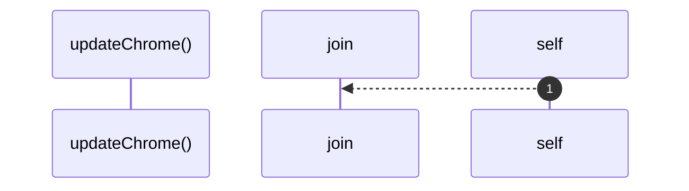

# `robby__site/src/viewer/updateChrome`

[Self-model](../../../README.md) · [robby__site/src/viewer](index.md)

| | |
|---|---|
| kind | `code.function` |
| location | [`apps/site/src/viewer.ts:556`](../../../../../apps/site/src/viewer.ts#L556) |
| provenance | extractor · confidence 1.00 |

```rust
function updateChrome(): void {
  crumbEl.textContent = ancestors(focusId)
    .map((id) => frame(id).name)
    .join(" / ");
  zoomOutBtn.disabled = !frame(focusId).parent;
}
```



1 steps · 0 observed · 1 possible only

## Referenced by

- calls ← [`robby__site/src/viewer/remount`](remount.md)

