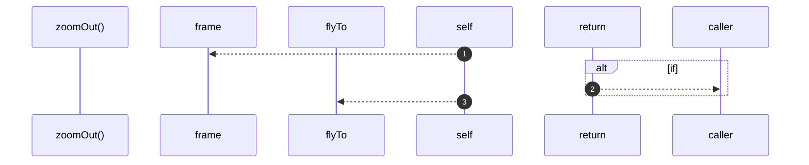

# `robby__site/src/viewer/zoomOut`

[Self-model](../../../README.md) · [robby__site/src/viewer](index.md)

| | |
|---|---|
| kind | `code.function` |
| location | [`apps/site/src/viewer.ts:771`](../../../../../apps/site/src/viewer.ts#L771) |
| provenance | extractor · confidence 1.00 |

```rust
function zoomOut(): void {
  const parent = frame(focusId).parent;
  if (!parent) {
    return;
  }
  flyTo(parent);
}
```



3 steps · 0 observed · 3 possible only

**Edges**

- calls → [`robby__site/src/viewer/frame`](frame.md)
- calls → [`robby__site/src/viewer/flyTo`](flyto.md)

## References

- calls → [`robby__site/src/viewer`](index.md) — flyTo, frame

